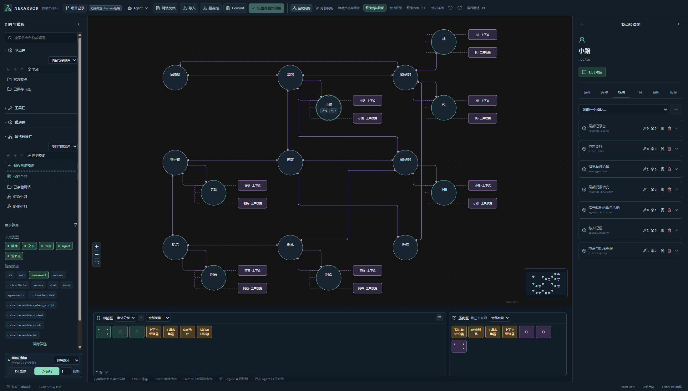

# 织林 · Nexarbor

**把想法连成网络，把网络变成应用。**

织林是一个**可视化的通用 Agent 应用开发平台**：把 Agent、数据、工具和模块拖进同一张画布，通过连接与参数组装应用；也可以直接用自然语言许愿，让制作 Agent 帮你搭网络、造组件、测试和迭代。



*NPC 小镇工作台实拍：画布按移动频道展示居民与地点，右侧直接查看选中角色的能力。*

## 你为什么会需要这个终端？

当一个应用拥有多个 Agent、持续积累的数据和不断增加的能力，**清晰的结构，就是继续扩展它的底气**。织林把这些关系放到你看得见、改得动的地方。

- **结构一目了然**：节点表达对象，连接表达访问关系，模块表达能力。谁能访问什么、能力装在哪里，都有明确的位置；选中一个局部，就能查看配置、追踪依赖，带着问题咨询 Agent。
- **能力留在局部组件里**：移动、消息、记录、上下文组装各司其职。通过参数与连接组合行为，一个好组件可以服务多个节点、多个网络和多个项目。
- **把耦合挡在架构边界之外**：应用规则由组件实现，核心负责通用机制，通信层承接协议，前端负责交互。组件通过声明的依赖与统一的 `ctx` 接口协作，模型执行器通过适配器接入，让界面、宿主与业务能够分别演进。
- **成果可以持续积累**：一个调好的节点、一组协作成员，甚至整个应用，都能成为下次拖入画布的零件。项目保存在自己的文件夹里，版本交给真实 Git 管理，修改有历史，探索有分支。

## 一套框架，搭出完全不同的应用

从讨论小组、去中心化协作团队，到知识归档系统，再到拥有地点、道路、交易与私人记忆的 NPC 小镇，**改变组件、参数和连接方式，就能组织出不同的应用形态**。

织林的泛用性来自可组合的能力：同一个记录模块可以管理任务、物品或业务数据；同一个上下文组装器可以服务角色、研究助手或协作成员；同一套网络既能独立运行，也能作为零件装进更大的网络。亚节点进一步把专用能力和连线收进局部，复杂应用也能保有清楚的结构。

**优先配置，充分复用，按需扩展。** 组件的前端负责把通用能力变成具体效果；真正缺少能力时，再制作新组件。你的组件库和网络预设，会随着每一次搭建变得更有价值。

## 许愿式编程：说出你想实现的效果

> “我想在当前网络里增加一个共享任务板，让这几个成员认领任务，完成后自动记录结果。”
>
> “这个角色为什么需要这个模块？保留现有行为，帮我调整它的参数。”

你可以围绕**整个当前网络、选中的节点与连接，或者一个具体模块**直接提出需求。网络预设制作 Agent 负责组织网络，组件／模块制作 Agent 负责补齐能力；网络制作也可以按开关决定是否调用组件制作。

制作过程带着真实环境展开：读取当前网络与选中内容，查阅组件接口和教程，优先复用现有能力，在工作副本中修改，再用当前网络的独立副本测试。对话、源码、验证结果和修改历史都留在工作台里，方便检查与继续迭代。

**从“我想实现什么”开始，把搭建、编程与验证连成一条工作流。** 你既能亲手拖拽和调参，也能让 Agent 接手其中的制作步骤。

## 灵感：让网络定义行动空间

随着模型的推理、规划与工具使用能力增强，Agent 能承担更多自主决策。织林由此出发：**用图表达信息访问、能力连接与协作边界，让 Agent 在明确的行动空间里自主选择、组织协作。**

## 像搭积木一样操作

- **搭建网络**：拖入节点、工具、模块和网络预设，编辑连接与频道；完整网络也可以作为零件加入另一张网络。
- **配置与复用**：模块提供配置表单或自己的前端页面。节点、模块、工具和子网都能保存为书签；历史保留独立快照，按配置去重并把最近使用的条目置前。
- **整理项目资源**：左侧资源栏采用文件夹与路径导航，支持分类、多选、剪切、拖动、归档和恢复；虚拟分类不改变组件本身的存储结构。
- **观察和运行**：查看节点的模块、工具与数据，进入 Agent 对话，运行脉冲，预览上下文来源，并在对应节点查看缺失模块等错误。
- **借助 Agent 制作与咨询**：围绕当前网络或选中部分提出需求、询问模块用途，建立修改副本，在独立网络副本中验证，再决定是否采用。
- **保存项目版本**：在项目文件夹中使用真实 Git，通过 Commit 保存网络、资源和 Agent 上下文位置；支持导入、另存为及版本分支。

左右侧栏可以折叠、调整宽度。代码区按需展开，资源和较重的界面按需加载；切换网络时，加载状态限制在画布区域。

使用方式见 [工作台指南](docs/NETWORK_EDITOR.md)。

## 节点、模块与连接

| 概念 | 职责 |
| --- | --- |
| 节点 | 网络中的独立对象，可以是 Agent、普通节点、文本、数据或脉冲；拥有自己的配置与装配内容。 |
| 亚节点 | 挂在节点或另一亚节点上的小容器，拥有独立的模块、工具和出边表，没有独立的数据存储与散度。 |
| 模块 | 通过统一的 `ctx` 接口实现行为，声明操作、配置、状态、依赖及可选的前端页面。 |
| 工具 | 提供给 Agent 使用的能力入口，可以由模块携带；拖入时自动补齐实现模块及依赖，已有装配会去重。 |
| 连接 | 从一个对象到另一个对象的定向接口，按频道、门槛、倍率及访问强度决定可达范围。 |
| 网络预设 | 保存为文件的可复用网络结构，包含配置与关联数据；可声明一个重复单元及其数量。 |

网络不要求保留根节点，也可以为空。节点上的模块默认访问强度与具体模块的授权分别配置；模块可以覆盖节点提供的默认值。

亚节点在画布上显示为更小的矩形，归属关系用无箭头虚线表示。虚线不是业务连接，不单独占用寻路步数。父对象可以本地调用亚节点的模块；两边的模块表和工具表保持独立。是否借用父对象出边、是否向父对象开放自己的出边，由两个开关分别控制，嵌套时逐层生效。

普通访问与信号传播共用频道和强度规则。独立访问可以并行，信号按层传播、同层并行。节点锁用于确实需要隐藏中间状态的原子修改，不用来包住整个 Agent 活动或普通消息收发。

参见 [模块与访问协议](docs/LOCAL_MODULES.md)、[亚节点与独立出边](docs/SUBNODES.md)。

## 看得见、能配置的上下文

通用上下文组装器将来源分成四类：

| 输入 | 用途 |
| --- | --- |
| `system_prompt` | 当前系统指令快照，例如职责和行为规则。 |
| `context` | 需要进入上下文的资料，按稳定来源和正文变化更新。 |
| `inputs` | 带稳定事件编号的一次性输入，避免重复投递。 |
| `tail` | 每次请求重新读取的当前状态快照，例如时间文本。 |

来源可以是直接文本、项目内的文本路径，或按指定频道连接的文本节点。组装器可以串联、合并和去重；工作台预览会显示来源、匹配情况和错误，不消费一次性事件。

组装器可以装在角色的亚节点上，通过显式准备入口供角色本地调用。时钟、记忆、地点查询各自提供能力；时间显示由普通文本与配置表达，不需要把整套应用规则写进一个角色模块。

参见 [上下文组装说明与设计案例](docs/CONTEXT_ASSEMBLER_CASE_STUDY.md)。

## 三个示例项目

| 项目 | 展示内容 |
| --- | --- |
| 固定讨论与协作组 | 讨论成员、去中心化协作成员、私人记忆、公共讨论板、共享任务板与公告箱。 |
| 知识归档与恢复 | 知识归档、修订与恢复，以及 JSON、CSV、SQLite、RAG 和 Wiki 等数据节点。 |
| NPC 小镇 | 居民、地点、道路、时间、并行活动、移动、消息、资源、交易和家庭关系。 |

这些示例通过组件与网络配置组合，核心不包含“小镇居民”或“协作组员”这样的应用角色。

协作组与讨论组另有可调人数的零件预设：选中预设，在右侧填写**可重复单元数量**，再拖入画布。框架重复生成成员，公共资源保留一份。每次实例化都会重新分配节点编号和存储路径，内部引用跟随新副本；没有声明数量参数的预设维持普通拖动方式。

参见 [预设数量参数](docs/PRESET_PARAMETERS.md)。示例配置位于 `configs/fixed_groups_v3/`、`configs/knowledge_v3/` 和 `configs/npc_town_v3/`。

## 一个文件夹，一个 Git 项目

没有打开项目时，客户端提供“打开项目文件夹”和“新建项目文件夹”。新建会初始化 Git、项目清单、资源目录及 `打开项目.cmd`。之后可直接从该文件夹启动客户端。

```text
项目文件夹/
├─ nexarbor.json              项目清单
├─ 打开项目.cmd               启动当前项目
├─ context/                   项目文本资料
├─ modules/                   当前项目的模块源码
├─ tools/                     当前项目的工具声明
├─ node_presets/              保存的节点模板
├─ network_presets/
│  ├─ fragments/              零件网络预设
│  └─ networks/               已存储的完整网络
├─ networks/                  Commit 保存的网络、节点与数据
└─ .nexarbor/                 上下文记录、运行数据与缓存
```

运行时从项目文件夹读取资源。资源库中的模块或工具需要下载到项目后使用，因此项目可以保留自己的实现版本。

客户端的几个操作分别负责：

- **Commit**：通过 Git 保存项目版本，包含网络、资源和 Agent 上下文的日志位置。未变化的内容由 Git 复用。
- **校验并更新网络**：检查当前编辑内容，并将其更新到运行网络。
- **另存为 / 导入**：导出或恢复完整网络及可携带的上下文；修改后继续运行时可以建立上下文分支。

退出时的工作页面会恢复。复制节点或子网会保留应有的配置和独立数据，重新映射内部连接；保留外联的复制方式仍指向原有外部对象。复制 Agent 不继承原会话上下文。

## 安装与启动

**运行要求：Windows x64、Git for Windows、已安装并完成账户授权的 [DeepSeek Harness](https://github.com/deepseek-ai/deepseek-harness)。Agent 执行统一使用 Harness 原生运行时。**

从 [0.8 Release](https://github.com/kazari-qwp/Nexarbor/releases/tag/v0.8.0) 下载 `Nexarbor-0.8.0-win-x64.zip`，完整解压后双击 **Nexarbor.exe**。运行包内置 Electron、Python 与基础依赖，启动后即可新建或打开项目文件夹。

模块、工具从资源库下载到当前项目后装配，递归依赖自动补齐。点击“校验并更新网络”使编辑生效，点击 **Commit** 保存版本。向量检索与本地模型依赖按需安装。

详细要求、Harness 授权位置、资源装配和源码构建见 [安装与装配指南](docs/INSTALLATION.md)。

## 代码结构

当前开发源码采用 **v8 网络格式**与 **v3 模块协议**。Python 命名空间与 Harness 插件沿用 `datanet` / `datanet-harness` 标识。

| 层 | 主要目录 | 职责 |
| --- | --- | --- |
| 核心层 | `python/datanet/core/` | 图、归属、访问、信号、事务、模块、输入契约、预设展开与持久化。 |
| 通信层 | `python/datanet/communication/`、`communication/` | 双向 JSON-RPC、HTTP、浏览器请求与模块页面桥。 |
| 前端层 | `frontends/network-editor/`、`frontends/desktop/` | 画布、资源管理、工作台、制作界面和桌面窗口。 |

`adapters/harness/` 负责具体宿主的装配与适配；`extensions/` 保存可组合组件与应用能力；`shared/` 放不依赖宿主或界面的公共格式契约。

核心不导入前端或 Harness 实现。通信通过处理函数和端口连接宿主服务，前端通过请求接口使用能力。本地回归检查这些分层边界和通信行为。

参见 [架构与阅读入口](docs/ARCHITECTURE.md)、[组件装配](docs/COMPONENTS.md)。

## 验证与进一步阅读

验证覆盖核心权限、信号并行、节点事务、模块依赖、独立存储、上下文装配、Git 项目与客户端交互。测试源码、实测日志和阶段报告保留在本地开发目录，通过 `.gitignore` 排除；发布包只包含运行资源与必要使用文档。

| 想了解的内容 | 文档 |
| --- | --- |
| 使用桌面工作台 | [客户端指南](docs/NETWORK_EDITOR.md) |
| 理解核心与三层边界 | [架构说明](docs/ARCHITECTURE.md) |
| 编写模块、调用 `ctx` | [模块协议](docs/LOCAL_MODULES.md) |
| 使用亚节点与私有出边 | [亚节点说明](docs/SUBNODES.md) |
| 组件制作、验证与发布 | [组件工作室](docs/COMPONENT_STUDIO.md) |
| 配置上下文来源 | [上下文组装案例](docs/CONTEXT_ASSEMBLER_CASE_STUDY.md) |
| 配置预设的重复数量 | [预设参数](docs/PRESET_PARAMETERS.md) |

欢迎围绕通用组件、网络预设、编辑体验和核心机制提交 Issue 或 Pull Request。新功能优先考虑能否复用现有组件，通过配置解决；业务逻辑放在组件内，宿主细节留在适配器中。

## 许可证

项目许可证尚未确定，后续以仓库提供的 `LICENSE` 为准。第三方宿主、依赖和相关材料遵循各自许可证。

[English README](README_EN.md)
