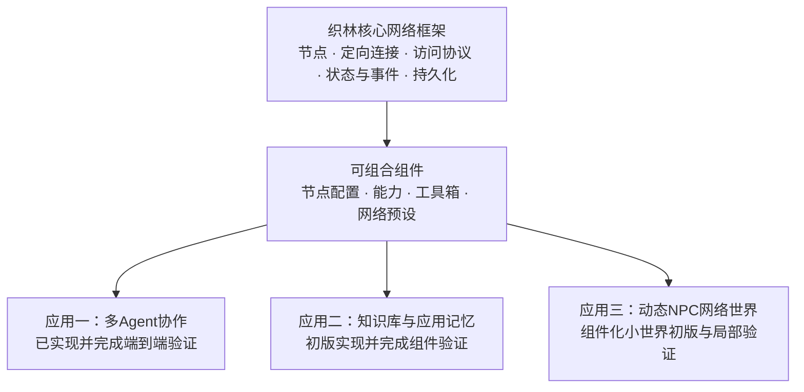

# 织林 · Nexarbor

[简体中文](README.md) | [English](README_EN.md)

**数据与智能的动态网络 · A Dynamic Network for Data and Intelligence**

随着新一代模型的推理、规划与工具使用能力增强，Agent 能够承担更多自主决策。Nexarbor 从这一趋势出发，将图主要用于表达访问权限与能力连接，让 Agent 在明确的边界内主动选择行动、组织协作。

与以执行流程为主要表达对象的图编排思路相比，Nexarbor 更关注：**谁能访问哪些信息、使用哪些能力，以及与谁交互。网络定义行动空间，Agent 在其中决定如何完成目标。**

织林将 Agent、数据与工具组织成可动态调整的网络。通过改变信息共享范围、能力分配和组织结构，同一套核心框架可以构建不同类型的应用：协作团队、知识库与记忆网络，以及动态 NPC 世界。

## 核心思路：让网络定义行动空间

在织林中，一条连接主要表达可访问、可交互的范围。连接到资料节点，Agent 可以按权限查阅资料；通过相应接口联系其他 Agent，可以交流或委托；装配工具箱后，框架授予并检查对应工具的调用权限。连接存在，并不意味着下一步必须执行那个节点。

框架负责访问规则与能力边界，Agent 根据目标、可获得的信息和工具结果决定下一步。应用仍可以通过组件规定讨论轮次、任务认领、验收和结束条件，把自主判断与确定规则组合起来。

**主动性有明确的授权范围。** 网络可以由使用者预先配置，也可以由获得组网权限的 Agent 调整。普通 Agent 只获得职责所需的接口；固定拓扑、有限调整和自主组网都可以成为应用的选择。

| 网络组织方式 | 可以构建的应用 |
|---|---|
| 共享项目资料、局部交流、委托和成果验收 | 从讨论方案到工程交付的协作团队 |
| 固定归档与检索角色，连接不同存储节点 | 可分类、可追溯、可读取的知识库与应用记忆 |
| 分层记忆、位置与关系决定的信息和交互范围 | 离散时间 NPC 网络世界 |

网络结构为不同工作方式提供基础，具体行为由 Agent、权限配置和业务组件共同实现。**我们希望把组织智能体、数据与能力的方式，变成可以保存、复用和持续演化的网络。**

项目名称为 **织林 / Nexarbor**。Python 命名空间与 Harness 插件目前沿用 `datanet` / `datanet-harness` 技术标识；当前插件版本为 **0.4.0**。本文包含组件化与知识库的最新开发进展；实现状态详见各应用验证记录。已发布安装包的内容以对应 Release 为准。

## 项目结构：一个核心，三个应用



多 Agent 协作是核心框架的第一个应用，已完成真实客户端端到端测试；知识库与应用记忆已有初版，并完成组件及原生桥接验证；动态 NPC 小世界已有初版与局部验证。三者共享网络基础，各自的业务规则通过组件实现。

## 核心框架

织林用节点表示数据、智能体与可调用能力，用定向连接描述它们之间的访问关系。网络结构可以在运行中调整，具体任务通过合适的组件组合完成。

| 基础能力 | 作用 |
|---|---|
| 节点与统一访问协议 | 不同数据类型提供一致的描述、读取、写入与工具发现入口 |
| 定向连接与访问控制 | 分别组织读写路径，通过连接门槛、可见性与访问预算控制传播范围 |
| 管理关系与Agent身份 | Agent节点绑定独立记忆，管理关系与数据连接分别表达职责和访问 |
| 状态、序列化与检查点 | 保存网络结构、节点配置和运行状态，为恢复与持续任务提供基础 |
| 组件清单与依赖装配 | 独立添加、启用、停用和替换能力，保留持久数据 |
| 通用事件与宿主通信接口 | 组件响应图变更、执行和上下文事件；宿主特有的循环、会话和工具由适配层对接 |

Python核心框架位于 `python/datanet/core/`。共享能力按组件放在 `extensions/foundation/` 与 `extensions/storage/`；第一应用由 `extensions/multi_agent/extension.json` 组合，第二应用由 `extensions/knowledge_base/extension.json` 组合，第三应用由 `extensions/npc_world/extension.json` 组合。Harness 适配位于 `adapters/harness/`；`executors/minimal/` 提供不依赖 Harness 的可选模型循环。核心、适配层、执行器和协作扩展包分别维护。

**组件是可复用的能力单元，应用是组件与网络的组合。** 工具箱组织可授予 Agent 的工具，网络预设提供可直接使用的结构；框架按组件清单解析并加载所选能力及其依赖，共享实现只保留一份。存储、检索、页面生成与 Agent 执行等扩展能力优先复用成熟实现，再适配为组件。详见[组件装配](docs/COMPONENTS.md)和[第三方能力复用](docs/THIRD_PARTY_COMPONENTS.md)。

详见[架构与事件接口](docs/ARCHITECTURE.md)和[组件拆解表](docs/COMPONENT_MAP.md)。不使用 Harness 时，可选用[独立执行器](executors/minimal/README.md)。

## 应用一：多 Agent 协作与工程交付

当前应用已经实现：

- 可配置人数的讨论组和去中心化项目组，也支持根自主创建Agent并组织拓扑。
- 独立会话、个人记忆、公共笔记、按需查询的项目资料与输出板。
- 异步委托、持久FIFO队列、消息插话与结果回送。
- 任务认领、文件范围管理、个人Git工作树、成果整合与共同验收。
- 报告索引、成员退出隔离、有限次格式纠错和终端任务生命周期管理。
- 同根网络内的Agent复用、离线网络归档与空闲释放。

讨论组适合生成观点、澄清需求与制定方案；执行组适合在方案和接口确定后实现、自测、整合与交付。二者可以衔接，也可以分别使用。

### 已验证的交付表现

在hone CSV→嵌套JSON项目的六轮已完成固定网络测试中，**六轮成果均通过12项库测试与6项CLI检查**。最近两批真实客户端对比中的固定网络同样全部通过；框架持续调整缓存、上下文和通信机制，完成交付的质量保持一致。

这些成绩属于第一个应用的工程回归记录。完整展示包括两批对比、Token费用、历史结果及优化路线：

**[应用一：架构优势与测试汇总](docs/applications/agent_collaboration/README.md)**

## 应用二：知识库与应用记忆

固定网络与两个按需 Agent，自动分类、复用或创建 CSV、SQLite、RAG 和 Wiki 集合。普通读取、筛选和检索直接执行，复杂归档与查询才调用 Agent。

底层复用 pandas、SQLite、LlamaIndex 和 MkDocs，通过同一套节点、权限与组件依赖机制装配。支持来源引用、版本、完整取回、导出及重启恢复。参见[知识库使用说明](docs/applications/knowledge_base/README.md)、[组件装配](docs/COMPONENTS.md)与[组件及知识库验证](docs/VALIDATION_COMPONENT_KNOWLEDGE.md)。

## 应用三：动态 NPC 网络世界

第三个应用已经以独立组件实现一个九地点、六居民的离散时间小世界。NPC 在地图中移动，框架随位置迁移双向在场接口，从而改变可用工具和交谈对象。地址仅暴露移动入口，业务节点提供修理、交易、劳动与家庭登记等能力。

每天五个时刻，居民并行选择行动，提交后统一结算；只读常识、私人记忆和世界事实分别维护。两天生育规则可创建真正的儿童 Agent，下一时刻进入网络。复用原有图权限、Agent执行和检查点，核心未加入世界业务。

已完成模拟闭环和单 NPC 真实 Harness 验证；本次没有运行完整世界的真实 Agent。参见[NPC小世界使用与组件说明](docs/applications/npc_world/README.md)。

## 快速开始

### 方式一：使用当前 Harness 应用

当前提供Windows x64后端，已在DeepSeek Harness `0.2.0-rc.2`环境验证。

1. 准备客户端、模型服务与API配置。
2. 从 [v0.4.0 Release](https://github.com/kazari-qwp/Nexarbor/releases/tag/v0.4.0) 下载 `datanet-harness-0.4.0.tgz`，导入客户端并启用插件。
3. 配置 `cordis.patch.yml` 中的工作目录、存储位置与模型路线。
4. 进入网络管理Skill，或直接使用网络管理工具创建节点及网络。

正式安装包通过 GitHub Releases 分发。源码仓库可按下方步骤构建，产物位于 `build/datanet-harness-0.4.0.tgz`；安装包和构建目录不提交 Git。

Agent循环、工具执行和会话由Harness原生运行时负责，织林组件负责网络结构与业务协作。模型配置与登录使用宿主客户端设置。

### 方式二：使用Python网络基础

在仓库根目录配置Python路径：

```powershell
$env:PYTHONPATH = (Join-Path (Get-Location) "python")
```

下面的示例不调用模型：

```python
from datanet.core.network import Network
from datanet.core.interface import Interface
from datanet.core.node import Node
from datanet.core.text_node import TextFileNode
from datanet.core.agent_node import AgentNode

network = Network()
source = Node("source", "访问起点", None)
data = TextFileNode("data", "数据节点", "text", "data.md")
data.write("content", "你好，织林", mode="upsert")
source.read_interfaces.append(Interface("data", visibility="public"))
network.add_node(source)
network.add_node(data)
network.add_node(AgentNode("worker", "Agent", file_path="worker-memory.md"))

result = network.read("source", {"method": "key", "key": "content"}, strength=1)
print(result.items)
```

Python建议使用3.11。基础图与访问协议使用标准库；组件依赖按启用能力准备，例如CSV节点需要pandas，LlamaIndex节点需要相应可选依赖。

## 组件启停

```powershell
python scripts/components.py list
python scripts/components.py disable capabilities/experience
python scripts/components.py enable capabilities/experience
```

配置保存到 `extensions/multi_agent/profile.json`，重启时生效。停用组件会连带停用依赖它的组件，已有节点、文件和业务状态保留。宿主也可通过 `config.components` 覆盖配置。

增加组件时，在对应类别下新建目录与 `component.json`，声明入口、依赖、资源和工具归属。框架按清单发现组件。组件接口见[架构说明](docs/ARCHITECTURE.md)。

## 源码目录

```text
python/datanet/core/       核心网络框架
extensions/foundation/    独立基础能力组件
extensions/storage/       可复用数据存储与 Wiki 组件
extensions/multi_agent/   第一应用的角色、预设与组合
extensions/knowledge_base/ 第二应用的知识库组合
executors/minimal/        可选的独立 Agent 执行器
adapters/harness/         Harness通信、运行时与平台适配
scripts/                  组件管理、构建与评估工具
tests/                    基础协议、组件及原生联通测试
docs/                     架构、应用说明、开发与评估记录
build/                    本机构建及测试数据（不提交Git）
```

## 构建与验证

源码构建需要Python、PyInstaller、启用节点的依赖，以及Node.js/npm。下面是Windows PowerShell流程：

```powershell
python scripts/build_backend.py
Copy-Item -Path "build/dist/datanet-backend/*" -Destination "adapters/harness/runtime/backend" -Recurse -Force
python scripts/stage_plugin.py
Push-Location build/plugin-staging
npm pack --pack-destination ..
Pop-Location
```

构建脚本收集组件入口，生成Windows后端；暂存脚本按包清单收集文件并排除Python缓存。版本由 `package.json` 管理。

测试分别覆盖Python核心、组件生命周期、持久化、原生运行时联通和真实模型项目交付。按改动运行相关测试，入口与依赖见[验证记录](docs/VALIDATION.md)。真实模型测试使用付费API，应自行配置预算与截止时间。

## 发展路线

- **核心网络**：继续完善动态拓扑、访问协议、组件边界、状态恢复与可观测性。
- **协作应用**：发展更多角色和网络预设，优化团队组织、验收与长期记忆，并扩展真实项目基准。
- **知识库与记忆**：扩展资料格式和存储组件，改进自动归档、来源维护与跨集合检索，并验证更大规模数据。
- **NPC世界应用**：建立世界状态、事件传播、记忆与行为机制。
- **可视化与多模态**：通过交互图、节点缩略图与结构操作，让人和智能体更直观地理解网络。
- **适配与生态**：沿独立适配层连接更多宿主与工具，让成熟组件在不同应用之间复用。

织林希望让每一个成熟节点、工具和网络预设，都成为后续应用可以继续使用的积木。三个应用会推动同一核心成长，也会相互贡献数据组织、协作与动态交互能力。

## 文档与参与

- [框架与组件接口](docs/ARCHITECTURE.md)
- [组件拆解表](docs/COMPONENT_MAP.md)
- [组件装配与依赖](docs/COMPONENTS.md)
- [知识库与应用记忆](docs/applications/knowledge_base/README.md)
- [应用一与测试展示](docs/applications/agent_collaboration/README.md)
- [Agent指南与工具描述](docs/AGENT_REVIEW.md)
- [Agent记忆、复用与生命周期](docs/AGENT_LIFECYCLE_REVIEW.md)
- [开发验证记录](docs/VALIDATION.md)

欢迎围绕核心协议、独立组件、网络预设和应用设计提交Issue或Pull Request。业务功能优先放在组件中，宿主兼容放在适配层；改动应附对应说明和必要验证。问题反馈请提供版本、复现步骤与脱敏日志，勿上传API密钥和客户端凭据。

## 许可证

项目许可证尚未确定，后续以仓库提供的 `LICENSE` 为准。第三方宿主、依赖与相关材料遵循各自许可证。
