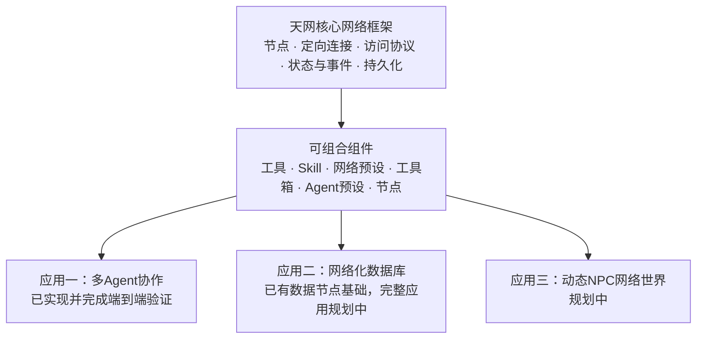

# 天网（数据与智能的动态网络）

**英文暂定：Tianwang · A Dynamic Network for Data and Intelligence**

天网的目标是建立一套通用的动态网络框架，让数据、智能体和能力能够被组织、连接、访问与演化。以统一的节点和连接为基础，天网希望承载从协作团队到数据库，再到动态 NPC 网络世界的多种应用。

**多 Agent 协作是这套核心框架的第一个应用。** 当前的讨论组、项目执行组和客户端测试，正在验证核心框架组织智能、连接数据与驱动工作流程的能力。接下来的数据库与动态世界应用，将沿用并继续发展同一套基础。

代码、Python命名空间与Harness插件目前沿用 `DataNet` / `datanet` 标识；项目中文名称暂定为天网。当前插件版本为 **0.3.16**。

## 项目结构：一个核心，三个应用



三种应用共享网络基础，各自的业务规则通过组件实现。后续应用可以复用已有能力，也可以添加自己的节点、工具和网络预设。

## 核心框架

天网用节点表示数据、智能体与可调用能力，用定向连接描述它们之间的访问关系。网络结构可以在运行中调整，具体任务通过合适的组件组合完成。

| 基础能力 | 作用 |
|---|---|
| 节点与统一访问协议 | 不同数据类型提供一致的描述、读取、写入与工具发现入口 |
| 定向连接与访问控制 | 分别组织读写路径，通过连接门槛、可见性与访问预算控制传播范围 |
| 管理关系与Agent身份 | Agent节点绑定独立记忆，管理关系与数据连接分别表达职责和访问 |
| 状态、序列化与检查点 | 保存网络结构、节点配置和运行状态，为恢复与持续任务提供基础 |
| 组件清单与依赖装配 | 独立添加、启用、停用和替换能力，保留持久数据 |
| 通用事件与宿主通信接口 | 组件响应图变更、执行和上下文事件；宿主特有的循环、会话和工具由适配层对接 |

Python核心框架位于 `python/datanet/core/`。讨论、协作、经验、排障、报告、异步队列与驻留策略等应用能力位于 `components/`。Harness适配位于 `adapters/harness/`，通过双向RPC连接Python本体与原生运行时。

**可组合、可拔插和可持续演化，是核心架构的设计重点。** 新的工作方式可以形成网络预设，新的能力可以形成工具或工具箱，新的数据形态可以形成节点；这些扩展可以继续服务后续应用。

详见[架构与事件接口](docs/ARCHITECTURE.md)和[组件拆解表](docs/COMPONENT_MAP.md)。

## 应用一：多 Agent 协作与工程交付

当前应用已经实现：

- 可配置人数的讨论组和去中心化项目组，也支持根自主创建Agent并组织拓扑。
- 独立会话、个人记忆、公共笔记、按需查询的项目资料与输出板。
- 异步委托、持久FIFO队列、消息插话与结果回送。
- 任务认领、文件范围管理、个人Git工作树、成果整合与共同验收。
- 报告索引、成员退出隔离、有限次格式纠错和终端任务生命周期管理。
- 同根网络内的Agent复用、离线网络归档与空闲释放。

讨论组适合生成观点、澄清需求与制定方案；执行组适合在方案和接口确定后实现、自测、整合与交付。二者可以衔接，也可以分别使用。

### 已验证的交付表现

在hone CSV→嵌套JSON项目的六轮已完成固定网络测试中，**六轮成果均通过12项库测试与6项CLI检查**。最近两批真实客户端对比中的固定网络同样全部通过；框架持续调整缓存、上下文和通信机制，完成交付的质量保持一致。

这些成绩属于第一个应用的工程回归记录。完整展示包括两批对比、Token费用、历史结果及优化路线：

**[应用一：架构优势与测试汇总](docs/applications/agent_collaboration/README.md)**

## 应用二：网络化数据库

第二个应用计划在核心框架上实现数据库：以节点和连接组织数据、关系与访问，让不同数据形态进入统一的网络协议，并与智能体能力自然协作。

当前已有单值、文本、CSV、SQLite及LlamaIndex数据节点组件，以及读写、条件查询和相应节点的语义检索基础。这些组件为数据库应用提供起点；完整数据库应用仍在规划中。

后续重点是数据组织与查询、存储与索引、关系访问和智能操作。具体能力与接口将在数据库应用设计中进一步确定。

## 应用三：动态 NPC 网络世界

第三个应用计划构建动态NPC网络世界：将NPC、场景、物品、记忆与事件组织为互连节点，让实体通过状态、关系、通信和行为共同推动世界变化。

核心框架的动态连接、独立记忆、事件驱动与持久状态，可以作为世界运行的基础。未来会进一步设计世界状态、行为规则、事件传播与交互界面，使智能体成为持续世界中的行动实体。

该应用目前处于规划阶段。现有多Agent测试验证了部分可复用的协作能力，完整世界系统将单独设计和验证。

## 快速开始

### 方式一：使用当前 Harness 应用

当前提供Windows x64后端，已在DeepSeek Harness `0.2.0-rc.2`环境验证。

1. 准备客户端、模型服务与API配置。
2. 在客户端导入已构建的 `datanet-harness-0.3.16.tgz`，启用插件。
3. 配置 `cordis.patch.yml` 中的工作目录、存储位置与模型路线。
4. 进入网络管理Skill，或直接使用网络管理工具创建节点及网络。

本地最新构建包位于 `build/datanet-harness-0.3.16.tgz`；构建目录不提交Git。源码仓库可按下方步骤生成安装包，之后再提供发布资产。

Agent循环、工具执行和会话由Harness原生运行时负责，天网组件负责网络结构与业务协作。模型配置与登录使用宿主客户端设置。

### 方式二：使用Python网络基础

在仓库根目录配置Python路径：

```powershell
$env:PYTHONPATH = (Join-Path (Get-Location) "python")
```

下面的示例不调用模型：

```python
from datanet.core.network import Network
from datanet.core.interface import Interface
from datanet.core.component_registry import codecs

network = Network()
ValueNode = codecs()["value"].node_class
source = ValueNode("source", "访问起点", "value", None)
data = ValueNode("data", "数据节点", "value", {"message": "你好，天网"})
source.read_interfaces.append(Interface("data"))
network.add_node(source)
network.add_node(data)

result = network.read("source", {"method": "key", "key": "value"})
print(result.items)
```

Python建议使用3.11。基础图与访问协议使用标准库；组件依赖按启用能力准备，例如CSV节点需要pandas，LlamaIndex节点需要相应可选依赖。

## 组件启停

```powershell
python scripts/components.py list
python scripts/components.py disable toolboxes/experience
python scripts/components.py enable toolboxes/experience
```

配置保存到 `components/profile.json`，重启时生效。停用组件会连带停用依赖它的组件，已有节点、文件和业务状态保留。宿主也可通过 `config.components` 覆盖配置。

增加组件时，在对应类别下新建目录与 `component.json`，声明入口、依赖、资源和工具归属。框架按清单发现组件。组件接口见[架构说明](docs/ARCHITECTURE.md)。

## 源码目录

```text
python/datanet/core/       核心网络框架
components/               六类可组合能力与应用组件
adapters/harness/         Harness通信、运行时与平台适配
scripts/                  组件管理、构建与评估工具
tests/                    基础协议、组件及原生联通测试
docs/                     架构、应用说明、开发与评估记录
build/                    本机构建及测试数据（不提交Git）
```

## 构建与验证

源码构建需要Python、PyInstaller、启用节点的依赖，以及Node.js/npm。下面是Windows PowerShell流程：

```powershell
python scripts/build_backend.py
Copy-Item -Path "build/dist/datanet-backend/*" -Destination "adapters/harness/runtime/backend" -Recurse -Force
python scripts/stage_plugin.py
Push-Location build/plugin-staging
npm pack --pack-destination ..
Pop-Location
```

构建脚本收集组件入口，生成Windows后端；暂存脚本按包清单收集文件并排除Python缓存。版本由 `package.json` 管理。

测试分别覆盖Python核心、组件生命周期、持久化、原生运行时联通和真实模型项目交付。按改动运行相关测试，入口与依赖见[验证记录](docs/VALIDATION.md)。真实模型测试使用付费API，应自行配置预算与截止时间。

## 发展路线

- **核心网络**：继续完善动态拓扑、访问协议、组件边界、状态恢复与可观测性。
- **协作应用**：发展更多角色和网络预设，优化团队组织、验收与长期记忆，并扩展真实项目基准。
- **数据库应用**：明确数据模型、存储与索引、查询接口及智能操作方式。
- **NPC世界应用**：建立世界状态、事件传播、记忆与行为机制。
- **可视化与多模态**：通过交互图、节点缩略图与结构操作，让人和智能体更直观地理解网络。
- **适配与生态**：沿独立适配层连接更多宿主与工具，让成熟组件在不同应用之间复用。

天网希望让每一个成熟节点、工具和网络预设，都成为后续应用可以继续使用的积木。三个应用会推动同一核心成长，也会相互贡献数据组织、协作与动态交互能力。

## 文档与参与

- [框架与组件接口](docs/ARCHITECTURE.md)
- [组件拆解表](docs/COMPONENT_MAP.md)
- [应用一与测试展示](docs/applications/agent_collaboration/README.md)
- [Agent指南与工具描述](docs/AGENT_REVIEW.md)
- [Agent记忆、复用与生命周期](docs/AGENT_LIFECYCLE_REVIEW.md)
- [开发验证记录](docs/VALIDATION.md)

欢迎围绕核心协议、独立组件、网络预设和应用设计提交Issue或Pull Request。业务功能优先放在组件中，宿主兼容放在适配层；改动应附对应说明和必要验证。问题反馈请提供版本、复现步骤与脱敏日志，勿上传API密钥和客户端凭据。

## 许可证

项目许可证尚未确定，后续以仓库提供的 `LICENSE` 为准。第三方宿主、依赖与相关材料遵循各自许可证。
