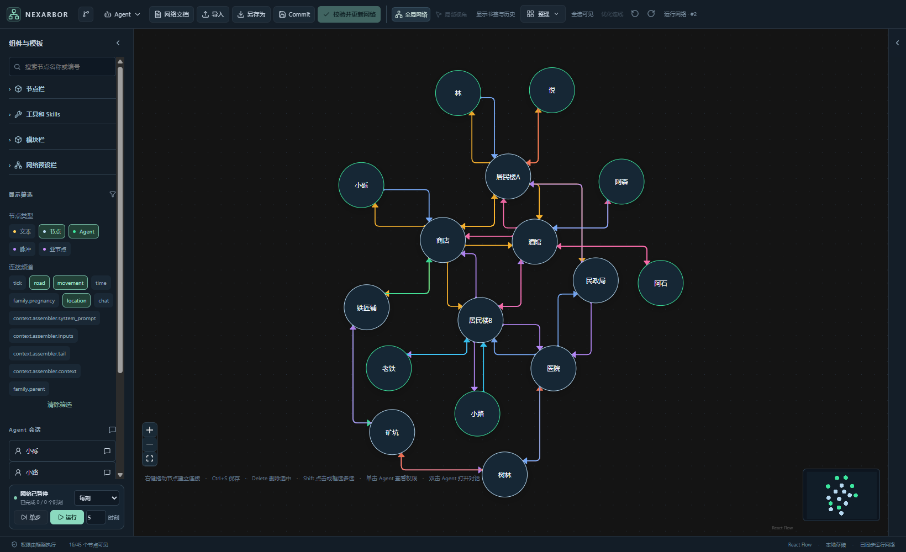
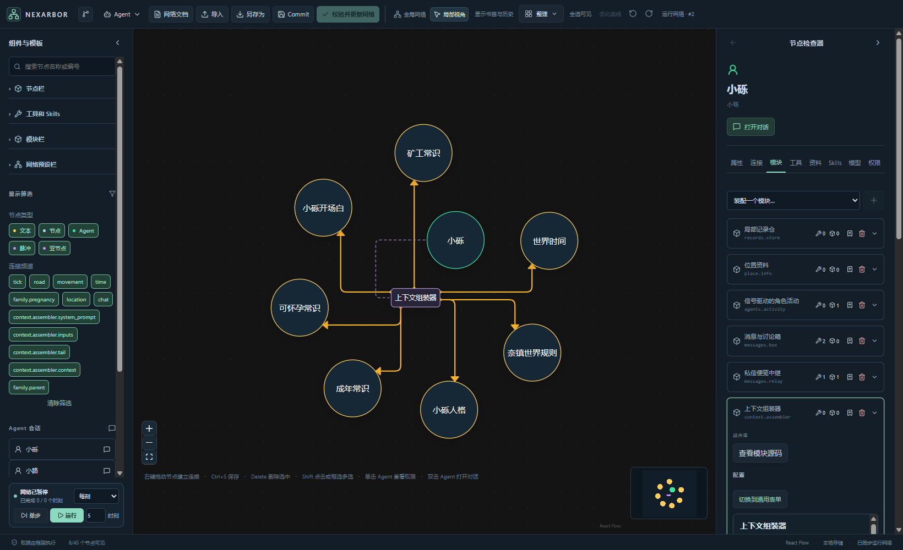
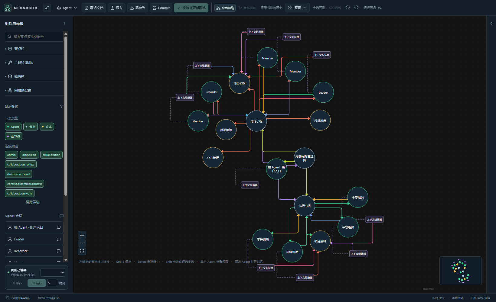
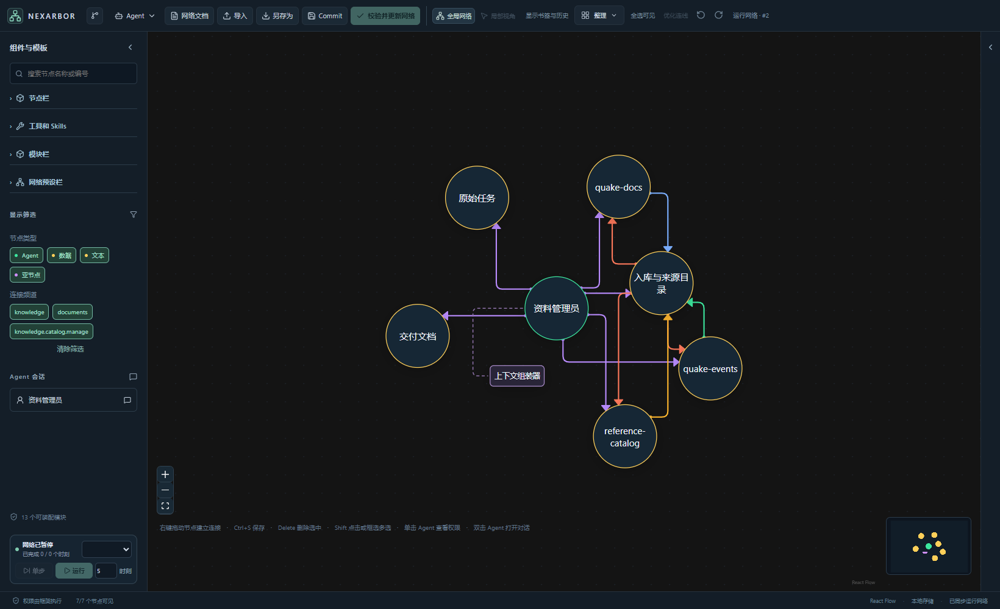

# 织林 · Nexarbor

织林是一个**可视化的 Agent 应用开发工作台**。把 Agent、数据、工具和模块放进同一张画布，用连接和频道划分访问范围，再通过参数和预设组装应用。你可以直接拖拽和配置，也可以让制作 Agent 围绕现有网络搭建、修改和验证。

> [!IMPORTANT]
> **运行前必须单独安装 Git 和 DeepSeek Harness（DSH）。** Nexarbor 运行包不包含这两项依赖，使用自己的模型 API key 也需要 DSH。



*NPC 小镇的工作台实拍。左侧筛选道路与位置相关频道，画布展示居民和地点之间的连接。*

## 快速上手

**运行环境为 Windows x64。先安装以下两项必需依赖，再启动工作台。**

| 必需依赖 | 在 Nexarbor 中的用途 | 安装要求 |
| --- | --- | --- |
| [Git for Windows](https://git-scm.com/downloads/win) | 项目版本管理、Commit、分支与恢复，以及协作组的 Git 工作区 | 安装时允许从命令行使用 Git。安装后新开终端，执行 `git --version` 能显示版本即可 |
| [DeepSeek Harness（DSH）](https://github.com/deepseek-ai/deepseek-harness) | 所有 Agent 的运行时，负责模型调用、会话与日志 | 安装 Windows 桌面版，使用 **0.2.1 或兼容版本**，当前已实测 0.2.1。工作台需要选择其 `DeepSeek Harness.exe`，0.2.0 缺少所需的原生服务 |

1. 下载 [Nexarbor v0.10.0 Windows 运行包](https://github.com/kazari-qwp/Nexarbor/releases/tag/v0.10.0)，完整解压并双击 `Nexarbor.exe`。包内已包含 Electron、Python 和基础依赖，无需另装 Node.js 或 Python。
2. 在首页或「设置 → DeepSeek Harness 路径…」选择已安装的 `DeepSeek Harness.exe`，保存后重新打开项目。模型授权可沿用 Harness 账户，也可在「设置 → 模型与 API」配置自己的 API 连接，并为单个 Agent 指定模型。**两种方式都通过本机 DSH 运行 Agent。**
3. 在首页选择「打开项目文件夹」，打开 `项目演示/` 中任意一个含 `nexarbor.json` 的项目目录。首次体验可以先打开最终项目看结构与成果，再复制初始项目开始运行。

安装、模型连接和可选的本地向量检索依赖见 [安装与运行指南](docs/INSTALLATION.md)。

## 在工作台里搭建应用

- **装配节点和能力。** 从左侧拖入节点、模块、工具、Skill 或网络预设。装配时按声明补齐依赖，已有能力会去重。模块可以通过表单或自己的前端页面配置。
- **查看网络与局部。** 按节点类型和连接频道筛选，使用层级或稠密整理重排当前视图。点击展示为亚节点的小矩形，可以聚焦父节点、该模块和它的频道直连节点，再用「全局网络」返回整张图。
- **保存可复用的结构。** 节点、连线、子网和资源可保存为书签。网络预设可以带参数，讨论组和执行组的预设可按成员数量展开。
- **运行与保存。** 在小镇等带脉冲的网络中，从左下角单步或运行多个时刻。编辑后点「校验并更新网络」应用草稿，再用 **Commit** 保存项目版本。



*点击小砾的上下文组装器后，画布聚焦该模块和相关资料，右侧定位到具体模块。*

| 操作 | 默认手势或快捷键 |
| --- | --- |
| 查看配置 | 单击节点或连线，在右侧查看属性 |
| 打开对话 | 双击 Agent 节点，历史消息从当前机器的 DSH 日志读取 |
| 建立有向连接 | 按住鼠标右键，从起点节点拖到终点节点 |
| 多选 | 按住 Shift 点选或框选，用 Shift＋滚轮扩展或收缩网络选区 |
| 保存书签 | 选中网络元素后按 A 保存内部连接，按 B 同时保留外部连接 |
| 编辑和提交 | Delete 删除选中元素，Ctrl＋Z 撤销，Ctrl＋Y 重做，Ctrl＋S 提交 |

快捷键可在「设置 → 外部文本编辑器与快捷键」调整。

## 用自然语言制作和修改

通过顶部 **Agent** 菜单打开网络制作或组件制作工作室，也可以右键节点、选区或已有资源，从当前对象发起咨询。网络制作 Agent 可以组合已有预设、修改节点与连线，缺少能力时可委托组件制作 Agent 编写模块或工具。

例如可以要求「为当前网络增加一个共享任务板，让成员认领任务并汇报结果」，或「解释这个角色的上下文从哪里来，帮我把世界规则接入系统提示频道」。制作 Agent 可以读当前网络、查阅项目接口、在工作副本中编辑，再用独立副本测试并提交成果。也可以从同一入口继续咨询已有设计。

## 网络怎样定义访问范围

| 概念 | 职责 |
| --- | --- |
| 节点 | 持有模块、工具与出边。数据节点和 Agent 在此基础上组合自己的能力 |
| 模块与工具 | 模块实现操作并声明配置、状态和依赖，也可以向 Agent 提供工具 |
| 连接 | 有向关系，带频道、阈值与倍率，用来约束一次访问或信号传播 |
| 模块亚节点 | 画布上用于查看模块的名称矩形，访问权限由真实节点间的连接决定 |

连接先检查频道和入口阈值，再按倍率处理强度。接收节点汇合输入并加上偏置，默认求和，也可选择最大值、最小值或平均值。例如强度 `4` 通过阈值 `3`、倍率 `1.5` 的边后，到达偏置为 `+1` 的节点，结果为 `7`。网络按广度分层推进，同层的异步操作可以并发。模块用 `@access` 声明访问范围，信号由独立运行器处理逐层推进、回源、取消和保存。

上下文组装器使用同一套网络访问规则，按频道收集四类输入。通过调整连接，可以改变角色每一轮看到的资料。

| 来源 | 内容 |
| --- | --- |
| `system_prompt` | 角色职责、规则与当前系统指令 |
| `context` | 随来源和正文变化更新的持续资料 |
| `inputs` | 按事件身份处理的一次性新输入 |
| `tail` | 每轮重新读取的动态状态，例如世界时间 |

## 三个应用，六份项目

每个应用都有初始项目和实际运行后的最终项目。初始项目适合继续搭建和运行，最终项目适合查看已保存的网络与业务结果。

| 应用 | 演示内容 | 项目 |
| --- | --- | --- |
| 讨论与协作 | 管理员用两个预设组网，讨论组定方案，执行组在真实 Git 工作区协作完成 CSV 转 JSON。最终 18 个节点、10 个 Agent，18 项产物检查及 9 项协议审计通过 | [初始](项目演示/应用1-讨论协作-初始/) · [最终](项目演示/应用1-讨论协作-最终/) |
| 知识资料库 | 导入、更新并检索 CSV、SQLite 和文档资料，使用 RAG 返回可定位到版本和章节的 Wiki 链接。最终项目保留 13 份完整原文，验收核对了 717 个版本哈希 | [初始](项目演示/应用2-资料库-初始/) · [最终](项目演示/应用2-资料库-最终/) |
| NPC 小镇 | 7 个居民 Agent 在有道路、地点、交易、记忆和随机事件的网络中活动。前五天完成 25 个时刻，随后从工作台续跑至第六天第 30 个时刻 | [初始](项目演示/应用3-NPC小镇-初始/) · [最终](项目演示/应用3-NPC小镇-最终/) |



*讨论与协作最终网络包含管理员、讨论组、执行组及任务资料。*



*资料库最终网络中的目录、集合和不同类型的数据节点。*

各应用的实测流程、断点恢复、耗时和 token 统计见 [验收记录](docs/migration/DELIVERY.md)。演示目录的打开方式见 [六份演示说明](项目演示/README.md)。

## 项目文件与代码结构

一个项目对应一个文件夹。`nexarbor.json` 声明网络和资源，`networks/`、`nodes/` 保存网络与节点，`modules/` 和 `tools/` 存放项目能力，`context/`、`data/` 与 `workspace/` 按需保存正文、业务数据和产物。Git 记录项目版本，DSH 负责模型会话。节点锁和局部事务用于协调并发修改与回滚。

| 目录 | 主要职责 |
| --- | --- |
| [`domain/`](domain/) | 节点、模块、工具、连接、数据抽象和 Agent 定义 |
| [`app/`](app/) | 项目装配、运行、信号、事务、持久化和制作工作室 |
| [`adapt/`](adapt/) | DeepSeek Harness、模型连接、文件操作及 RPC/HTTP 适配 |
| [`frontends/`](frontends/) | Electron 客户端、React 网络工作台与共享视图逻辑 |
| [`modules/`](modules/)、[`projects/`](projects/) | 内置工具发现与上下文组装，以及各应用自己的模块 |

阅读源码可从普通节点、`@access`、工具发现和上下文组装开始。目录、调用链和示例见 [项目结构与机制说明](PROJECT_OVERVIEW.md)。

## 从源码启动

在 Windows x64 上准备 Git、Python 3.11、Node.js/npm 和 DeepSeek Harness。以下命令在仓库根目录运行。

```powershell
python -m venv .venv-runtime
.\.venv-runtime\Scripts\python.exe -m pip install -r requirements-runtime.txt
npm install
npm --prefix frontends/network-editor install
npm --prefix frontends/desktop install
npm run build
npm start
```

启动后用工作台首页打开项目文件夹。默认生成参数位于 [`configs/agent-defaults.json`](configs/agent-defaults.json)，项目、制作职责和节点的独立配置优先。

从仓库根目录运行本地回归和 Windows 打包命令。

```powershell
.\.venv-runtime\Scripts\python.exe -B -m unittest discover -s tests
npm run test:frontend
npm run test:desktop
npm run package
```

打包结果位于 `build/release/`，包含 Windows x64 ZIP 和 SHA-256 校验文件。
