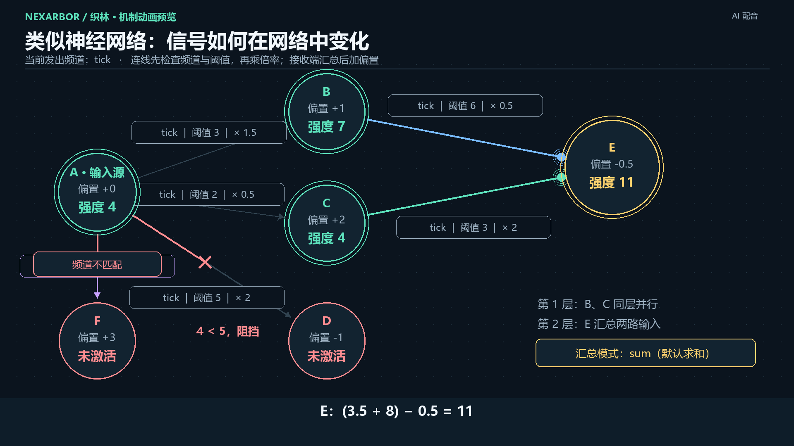

# Nexarbor · 织林

**Turn ideas into networks, and networks into applications.**

Nexarbor is a visual platform for building general-purpose Agent applications. Drag Agents, modules, tools and data onto a canvas, configure their connections, and ask maker Agents to extend or revise the application in natural language.


The same framework supports discussion groups, decentralized collaboration, knowledge archives and an NPC town. Reusable modules, local subnodes, explicit access boundaries and configurable frontends keep application structure understandable as it grows. The core, communication layer and frontend have separate responsibilities; Agents run through DeepSeek Harness.

## Install 0.9

- Windows x64 and Git for Windows on PATH.
- Install [DeepSeek Harness](https://github.com/deepseek-ai/deepseek-harness) and authorize your DeepSeek account there. The native adapter is verified with Harness 0.2.1; 0.2.0 lacks required SDK services. Upgrade Harness if startup reports a missing native service.
- Download the Windows x64 runtime ZIP from [Releases](https://github.com/kazari-qwp/Nexarbor/releases), extract the entire archive, then run `Nexarbor.exe`.

The archive includes Electron, Python and base dependencies. Local vector retrieval dependencies and model weights are installed on demand. A step-by-step [release setup and demo guide](#release-setup-and-demo-walkthrough) appears at the end of this README. See [installation and assembly](docs/INSTALLATION.md) for Harness paths, credentials and source builds.

## Projects and assembly

Create or open a project folder. Download modules and tools from the resource library into that project, drag them onto nodes, and configure their frontends. Dependencies load recursively and duplicate mounts are avoided. Validate and update the network to apply edits; **Commit** records versions using real Git.

Nodes, tools, modules, Skills and whole subnetworks can become reusable bookmarks or presets. Skills declare dependencies and expose detailed guidance on demand. Consultation and creation share conversations and resume the previous conversation by default. Network views support channel/type/module filters, high-contrast edges and hierarchical or compact layouts. Each project owns its resource implementations, network files, data and saved context positions. Copying an Agent creates a fresh conversation.

Running network state is persisted automatically; Git commits separately preserve version history.

The independent Python Agent executor and earlier plugin distribution have been retired. The desktop workbench requires DeepSeek Harness.

[中文完整说明](README.md) · [Architecture](docs/ARCHITECTURE.md) · [Module API](docs/LOCAL_MODULES.md) · [Release notes](docs/RELEASE_NOTES_v0.9.0.md)

## Core mechanics: connections determine behavior

**Nodes host modules; modules implement behavior and can expose tools to Agents.** Capabilities remain local, and modules cooperate through the network. Changing connections, channels and parameters changes application behavior and access ranges.

### Strength propagation, similar to a neural network

Connections have channels, thresholds and multipliers; nodes have biases. Each connection first checks **whether the channel matches and whether the current strength meets its threshold**. Accepted strength is multiplied by the edge multiplier. The receiving node aggregates its inputs, then adds its own bias. Aggregation defaults to sum, with maximum, minimum and mean also available.



In this diagram, A emits strength 4 on `tick`. B receives `4 × 1.5 + 1 = 7`, while C receives `4 × 0.5 + 2 = 4`. D is blocked by its threshold of 5, and F remains inactive because its channel does not match. On the next layer, E combines both incoming paths: `7 × 0.5 + 4 × 2 − 0.5 = 11`.

Signals advance **breadth first, one layer at a time, with asynchronous parallel execution within each layer**. B and C can respond concurrently before E combines their inputs on the following layer. Subsequent propagation follows the network topology at that time. An emitted signal propagates independently without waiting for a return value; a call is explicitly initiated by a module and returns its result to the caller.

### Channels and topology are part of the program

A module uses its access strength and a specified channel to obtain reachable node objects, then reads their data, tools and modules or calls their operations. `ctx.network.nodes()` returns these objects in breadth-first order, ready to use without repeating a graph search for each node. Context assembly and tool collection use this API. **Adjusting network parameters changes how far a module or signal can reach at a given strength.**

Context assembly is one example: rules and role descriptions are collected through the channel for `system_prompt`, while requests and messages use the channel for `inputs`. They populate the system prompt and new inputs separately. All text reachable on the corresponding channel is included. Text at the same layer precedes deeper text, so parallel branches and chains control content and ordering. Changing connections changes the assembled context.

## Mouse gestures, shortcuts and Agent entry points

These are the defaults; keyboard shortcuts and mouse gestures can be customized in Settings.

| Action | Gesture or shortcut |
| --- | --- |
| Assemble and reuse | Drag nodes or network presets from the left sidebar onto the canvas. Drop modules, tools or Skills onto nodes to install their dependencies recursively. |
| Inspect and move | Click a node or edge to edit its properties in the right panel. Drag nodes with the left mouse button. Double-click an Agent node to open its conversation. |
| Connect nodes | Hold the right mouse button and drag from the source node to the destination. A right-click without dragging opens the context menu. |
| Select multiple elements | Hold Shift to click or box-select. Shift + mouse wheel up expands the network selection; wheel down contracts it. |
| Bookmark a selection | Press A to save selected nodes, edges or a subnetwork with internal connections only; press B to also preserve external connections. Both options are available in the context menu. |
| Reuse an edge bookmark | Drop it onto the source node, then left-click the destination to complete the connection. Press Esc to cancel. |
| Manage bookmarks | Hover over a bookmark and press A or B to delete it, or middle-click to rename it. Hover over a node or network bookmark and press S to save it as a preset. Bookmarks and history support type filters and drag-and-drop reuse. |
| Edit and save | Delete removes selected elements; Ctrl + Z undoes; Ctrl + Y redoes; Ctrl + S commits the current edits through Git. |
| Send a message | Ctrl + Enter sends. Conversations also accept pasted images, file attachments and file paths. |

There are several entry points for the two assistant Agents:

- **Top Agent menu:** open the network Agent or module/tool Agent. The network Agent organizes networks; the module/tool Agent creates and revises components.
- **Left resource sidebar:** start a new module, tool or network preset. Right-click an existing module, tool or preset to ask about it or create a modification branch.
- **Canvas and right properties panel:** right-click a node or selection and choose the consultation action to discuss it with the network Agent. Modules and tools in the properties panel also have consultation context menus.

Consultation windows and the creation studio are entry points to the same functionality. **They share conversation history and resume the previous conversation by default.** Only an explicit new-conversation action starts a separate conversation. You can ask for changes directly and let the Agent continue in a working copy.

See the [workbench guide](docs/NETWORK_EDITOR.md) for more detail.

## Included projects

These projects accompany the current main-branch source; published archives retain the contents of their respective releases.

Application implementations live in ordinary project folders; the framework library keeps generic modules such as context assembly, tool collection, records, messaging and data access.

- [Preset-based compatibility project](projects/preset-compatibility/): starts with a root Agent and administrator; instantiate discussion and execution groups before the CSV-to-JSON task.
- [Assembled discussion/collaboration reference](projects/discussion-collaboration/).
- [Knowledge archive](projects/knowledge-archive/): starts empty and creates separate CSV, SQLite, RAG and Wiki collection nodes; supports provenance, versions, incremental ingestion and optional local vector search.
- [Agent-rebuilt town](projects/npc-town/) and the [maintained teaching sample](resources/examples/npc-town/), now the new initial-state project with 59 nodes and 19 project-owned modules, included by the packaging pipeline.

Copy a project folder to your workspace and open it in Nexarbor. Opening initializes local Git and a launcher. Configure your own model connection; credentials and old sessions are not distributed. Three functional compatibility runs used DeepSeek Flash:

- Preset-based CSV-to-JSON development passed all 18 historical checks, with every collaboration member approving the same candidate before submission.
- The knowledge application completed archive, query, update, history, restart and semantic-search-to-Wiki-source workflows. Two additional feedback rounds closed remaining ingestion items. Vector trials used a local BGE model; configure your own model directory in the source project.
- The town completed 25 ticks over five days plus restart recovery, without repeating opening inputs.

These results cover the tested workflows and recovery, rather than guaranteeing one-shot success for arbitrary tasks. Test reports, timelines, logs and temporary artifacts remain local. This update also fixes the node-chat blank screen, repeated UUID-based tool deactivation notices, and stale edge routes after switching channel filters.

## 0.9 configuration and demos

Select the installed Harness executable from the project home or Settings menu; the path is stored locally. Agent defaults are editable in [`configs/agent-defaults.json`](configs/agent-defaults.json): a 600,000-token context window and 50,000-token output limit, with explicit project/node settings taking precedence.

[`项目演示/`](项目演示/) ships six independent initial/final project folders for discussion/collaboration, knowledge archives and the NPC town. Final projects retain business data and portable conversation chunks. Credentials, local model weights and developer runtime caches are excluded. See the [demo guide](项目演示/README.md).

## Repository structure

```text
Nexarbor/
├─ frontends/
│  ├─ desktop/               Electron entry point and local Harness settings
│  └─ network-editor/        Graph canvas, resources, chat and maker UI
├─ python/datanet/
│  ├─ core/                  Graph, channels, signals, modules and persistence
│  ├─ communication/         Python protocol handlers
│  └─ components/            Component assembly support
├─ communication/            Browser client, HTTP and component frontend bridge
├─ adapters/harness/
│  ├─ framework/             Host integration, tools and context adaptation
│  ├─ runtime/               Harness Agent loop and runtime resources
│  └─ studio/                Workbench backend, projects and maker Agents
├─ extensions/               Generic modules, tools, Skills and component UI
├─ shared/graph/             Shared graph formats and assembly logic
├─ configs/
│  └─ agent-defaults.json    Editable 600k context / 50k output defaults
├─ projects/                 Application projects and reusable presets
├─ resources/examples/
│  └─ npc-town/              Bundled teaching project for maker Agents
├─ 项目演示/                 Six independent initial/final demo projects
├─ docs/                     Installation, architecture and protocol guides
└─ scripts/                  Component maintenance and release packaging
```

Generic components belong in `extensions/`; application behavior belongs in each project's `modules/`. Projects own their `nexarbor.json`, network definitions, texts and application data. Portable Agent history is saved in `.nexarbor/contexts/`; local runtime state and caches live under `.nexarbor/runs/`.

The portable release also supplies `Nexarbor.exe`, Electron resources, `runtime/python/` and compiled frontend assets. See [installation and source builds](docs/INSTALLATION.md).

## Release setup and demo walkthrough

### 1. Prepare the environment

- **Windows x64** and a writable folder for the extracted release.
- Install [Git for Windows](https://git-scm.com/downloads/win) with command-line access enabled. Open a new terminal and confirm that `git --version` prints a version number.
- Install [DeepSeek Harness](https://github.com/deepseek-ai/deepseek-harness). **Use 0.2.1 or a later compatible version; 0.2.1 is the verified version.** Before running Agents, authorize your account in Harness or configure your own model API connection in Nexarbor. Model calls require internet access and use your own account allowance or API billing.

The runtime archive includes Electron, Python and base dependencies, so **no separate Node.js or Python installation is required**. Local vector retrieval requires optional dependencies and embedding model weights; see the [installation guide](docs/INSTALLATION.md).

### 2. Download, extract and connect Harness

1. Open [GitHub Releases](https://github.com/kazari-qwp/Nexarbor/releases) and download **`Nexarbor-<version>-win-x64.zip`**, for example from [0.9.1](https://github.com/kazari-qwp/Nexarbor/releases/tag/v0.9.1). Choose the runtime ZIP under Assets; GitHub's automatically generated Source code archives contain source files.
2. **Extract the entire archive**, keeping `Nexarbor.exe`, `runtime/`, `configs/` and `项目演示/` in their original relative locations. Run the extracted `Nexarbor.exe`.
3. On the home screen, choose the DeepSeek Harness path, or use **Settings → DeepSeek Harness path** to select your installed **`DeepSeek Harness.exe`**. Save and reopen the project. This path is stored locally; select the installation on each computer you use.
4. Use your authorized Harness account, or configure a model connection under **Settings → Models and API**. Individual nodes and both assistant Agents also have model settings. API keys are not distributed with demo projects and must be configured again on a different computer.

Defaults are a **600k context window** and **50k maximum output**. Edit [`configs/agent-defaults.json`](configs/agent-defaults.json) in the extracted release and reopen the project to change them. Explicit project or node settings take precedence, and the selected model must support the configured limits.

**Since 0.9.2, consultation, maker and network Agents no longer stop at a model-request count, and runner-wide cumulative request and lifetime limits have been removed.** Execution waits and the associated signal, pulse and module-call deadlines are relaxed to 24 hours, including smaller legacy execution allowances at runtime. Tasks can still be stopped manually. Context capacity and per-response output length remain separate settings with the defaults above.

### 3. Open the six demo projects

The release's **`项目演示/`** folder contains six independent projects. Folder names remain in Chinese:

| Application | Start from the beginning | Inspect completed results |
| --- | --- | --- |
| Discussion and collaboration | `应用1-讨论协作-初始`: root Agent, administrator and two group presets. | `应用1-讨论协作-最终`: assembled discussion/collaboration groups and CSV-to-JSON project results. |
| Knowledge archive | `应用2-资料库-初始`: startup network and source material. | `应用2-资料库-最终`: CSV, SQLite, RAG and Wiki collections with archived results. |
| NPC town | `应用3-小镇-初始`: the town before its first run. | `应用3-小镇-最终`: relationships, supplies, memories and conversations after five days. |

**Recommended:** after configuring Harness, enter the desired folder and double-click **`打开项目.cmd`**. For example, use `项目演示/应用3-小镇-初始/打开项目.cmd` to open the initial town. The final discussion/collaboration project's first launch also restores Git history and member workspaces through its preparation script, so keep all project files together.

Alternatively, choose **Open project folder** on the client home screen and select the demo folder itself: the directory containing **`nexarbor.json`**. If you copy a demo outside the runtime package, prefer opening it through the client; the supplied launcher locates the executable relative to the package.

### 4. Explore, run and save

- **Inspect results:** open a final-state project, click nodes to inspect modules, tools and data, and double-click Agents to view conversations. Right-click a node to consult the network Agent.
- **Run the town from the beginning:** open `应用3-小镇-初始`. In the lower-left run panel, select the **每刻** pulse and click **单步** for one tick, or enter a tick count and click **运行**. Each tick activates multiple residents; completion time depends on model responses and tool execution.
- **Try discussion/collaboration or the archive:** open its initial-state project, double-click the entry Agent and send a request using the project's README and task materials as guidance. Initial and final projects are independent; final projects show completed results.
- **Apply edits and save:** after changing nodes, connections or module configuration, click **Validate and update network** to apply edits to the running network. Runtime state is persisted automatically. Click **Commit** or press Ctrl + S to additionally save a Git version you can return to.

Copy an initial project before experimenting if you want to preserve the original demo. The knowledge archive does not include local embedding model weights; configure a model path before using local semantic search. See [installation and assembly](docs/INSTALLATION.md) for details.
