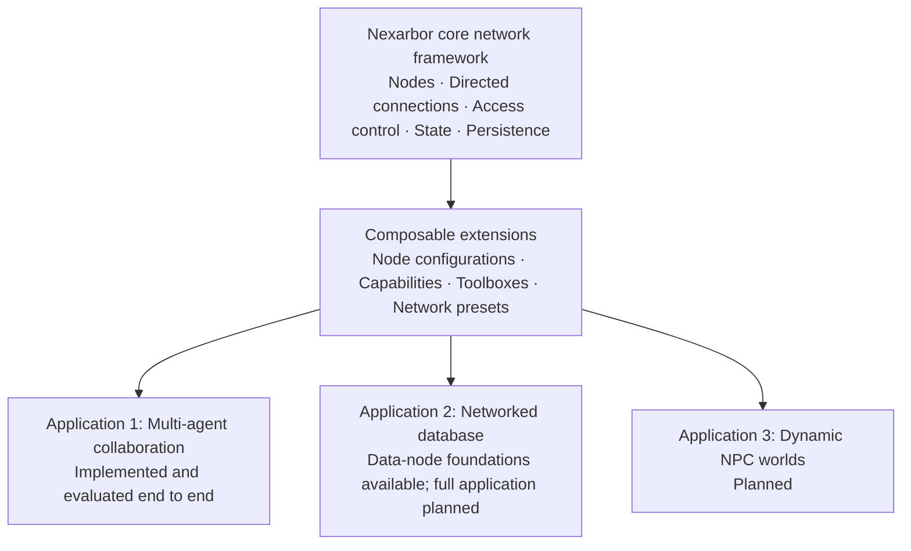

# Nexarbor

[English](README_EN.md) | [简体中文](README.md)

**A Dynamic Network for Data and Intelligence**

Nexarbor (织林) is a general framework for organizing data, agents, and capabilities as a dynamic network. Its shared foundation of nodes and directed connections is designed to support collaborative teams, networked databases, and dynamic NPC worlds.

**Multi-agent collaboration is the first application of the core framework.** Discussion groups, project teams, and real-client evaluations demonstrate how the framework organizes agents, connects data, and coordinates work. The planned database and dynamic-world applications will build on the same foundation.

The project is named **Nexarbor / 织林**. The Python namespace and Harness plugin currently retain the `datanet` / `datanet-harness` technical identifiers. The current plugin version is **0.4.0**.

## One core, three applications



The applications share the network foundation while keeping their business rules in separate components. Future applications can reuse existing capabilities or introduce their own nodes, tools, and network presets.

## Core framework

Nexarbor represents data, agents, and callable capabilities as nodes. Directed connections define access paths between them. Network structures can change at runtime, and components can be combined to match the task.

| Foundation | Purpose |
|---|---|
| Nodes and a shared access protocol | Consistent interfaces for describing, reading, writing, and discovering tools across data types |
| Directed connections and access control | Separate read/write paths with thresholds, visibility rules, and signal budgets |
| Management relationships and Agent identity | Agent nodes own independent memory; management and data-access relationships are represented separately |
| Serialization and checkpoints | Persist network structure, node configuration, and state for continued work and recovery |
| Component manifests and dependency assembly | Add, enable, disable, or replace capabilities while retaining persisted data |
| Events and a host communication interface | Let components respond to graph, execution, and context events through an independent host adapter |

The implementation is organized into four parts:

| Part | Location | Responsibility |
|---|---|---|
| Core | `python/datanet/core/` | Ordinary nodes, text nodes, Agent nodes, graph access, permissions, persistence, extension registration, and the executor contract |
| Harness adapter | `adapters/harness/` | Duplex RPC, native events, sessions, tool/context integration, and platform compatibility |
| Optional executor | `executors/minimal/` | A standalone Python agent loop with model/tool calls, history, messages, cancellation, and budgets |
| Collaboration extension | `extensions/multi_agent/` | Discussion, project collaboration, messaging, delegation queues, reports, experience, troubleshooting, and residency/reuse policies |

Inside an extension package, business code belongs in **capabilities**. Node and role configurations, guides, toolboxes, and network presets are configuration and documentation. A toolbox lists tool-entry IDs; the framework grants and enforces the corresponding permissions when it is assigned to an Agent.

**Composability, pluggability, and continued evolution are central design goals.** A new workflow can become a network preset, a new operation can become a capability, and a new data representation can become a node. These extensions can support later applications as well.

See the [architecture and event interfaces](docs/ARCHITECTURE.md) and the [component breakdown](docs/COMPONENT_MAP.md).

## Application 1: Multi-agent collaboration and engineering delivery

The current application provides:

- Discussion groups and decentralized project groups with configurable member counts, plus networks organized directly by the root Agent.
- Independent sessions and memory, shared notebooks, and project/output documents queried on demand.
- Asynchronous delegation, persistent FIFO queues, messages to running or idle Agents, and result delivery.
- Task claims, file-scope coordination, individual Git worktrees, integration, and shared acceptance.
- Report indexes, member-failure isolation, bounded malformed-response correction, and terminal-job lifecycle management.
- Agent reuse within a root network, detached-network archives, and idle unloading.

Discussion groups help generate ideas, clarify requirements, and develop plans. Project groups implement, test, integrate, and deliver work once a plan and interfaces are established. They can be used together or independently.

### Delivery results

Across six completed fixed-network runs of the hone CSV-to-nested-JSON project, **every delivery passed the same 12 library tests and 6 CLI checks**. The fixed network also passed all checks in both recent real-client comparison batches. Delivery quality remained consistent while caching, context, and communication mechanisms evolved.

These results are engineering regression records for the first application. The full presentation includes comparison batches, token costs, historical runs, and optimization work:

**[Application 1: Architecture strengths and evaluation history](docs/applications/agent_collaboration/README.md)**

## Application 2: Networked database

The second planned application is a database built on the network core: nodes and connections organize data, relationships, and access, bringing multiple data representations into a shared protocol that can work with agents.

Value, text, CSV, SQLite, and LlamaIndex node components already provide a starting point, including reads, writes, filtering, and semantic retrieval where supported. The complete database application remains planned.

Future work will define data organization and querying, storage and indexes, relationship traversal, and intelligent operations.

## Application 3: Dynamic NPC worlds

The third planned application is a dynamic NPC network world. NPCs, scenes, items, memories, and events become interconnected nodes whose states, relationships, communication, and actions drive the world forward.

Dynamic connections, independent memory, events, and persistent state provide a foundation. Future work will develop world-state models, behavior rules, event propagation, and interaction interfaces so agents can act within a persistent world.

This application is currently planned. Existing collaboration tests exercise some reusable capabilities; the complete world system will be designed and evaluated separately.

## Quick start

### Option 1: Use the Harness application

A Windows x64 backend is included. The integration has been verified with DeepSeek Harness `0.2.0-rc.2`.

1. Prepare the client, model service, and API configuration.
2. Download `datanet-harness-0.4.0.tgz` from the [v0.4.0 release](https://github.com/kazari-qwp/Nexarbor/releases/tag/v0.4.0), import it into the client, and enable the plugin.
3. Set the workspace, storage location, and model route in `cordis.patch.yml`.
4. Enter the network-management Skill or use a network-management tool to create nodes and networks.

Harness supplies the native agent loop, tool execution, and sessions. Nexarbor components manage network structure and collaboration. Model configuration and authentication use the host client.

### Option 2: Use the Python core

From the repository root, set the Python path:

```powershell
$env:PYTHONPATH = (Join-Path (Get-Location) "python")
```

This example makes no model calls:

```python
from datanet.core.network import Network
from datanet.core.interface import Interface
from datanet.core.node import Node
from datanet.core.text_node import TextFileNode
from datanet.core.agent_node import AgentNode

network = Network()
source = Node("source", "Access origin", None)
data = TextFileNode("data", "Text data", "text", "data.md")
data.write("content", "Hello, Nexarbor", mode="upsert")
source.read_interfaces.append(Interface("data", visibility="public"))
network.add_node(source)
network.add_node(data)
network.add_node(AgentNode("worker", "Agent", file_path="worker-memory.md"))

result = network.read("source", {"method": "key", "key": "content"}, strength=1)
print(result.items)
```

Python 3.11 is recommended. The basic graph and access protocol use the standard library. Install dependencies for the capabilities you enable, such as pandas for CSV nodes or the relevant optional packages for LlamaIndex nodes.

For a model loop independent of Harness, see the [optional executor](executors/minimal/README.md).

## Enable and disable components

```powershell
python scripts/components.py list
python scripts/components.py disable capabilities/experience
python scripts/components.py enable capabilities/experience
```

Settings are saved to `extensions/multi_agent/profile.json` and applied on restart. Disabling a component also disables components whose dependencies are no longer satisfied; existing files and persisted state are retained. The host can override settings through `config.components`.

To add a component, create a directory and `component.json` in the appropriate category. Declare its entry points, dependencies, resources, and tool ownership. See the [architecture documentation](docs/ARCHITECTURE.md).

## Repository layout

```text
python/datanet/core/       Core network framework
extensions/multi_agent/   Pluggable collaboration extension, with four component categories
executors/minimal/        Optional standalone Agent executor
adapters/harness/         Harness communication, runtime, and platform integration
scripts/                  Component management, builds, and reusable evaluation tools
tests/                    Core, component, and native integration regression tests
docs/                     Architecture, application guides, and evaluation records
build/                    Local builds and test artifacts; excluded from Git
```

## Build and validate

Building from source requires Python, PyInstaller, dependencies for enabled nodes, and Node.js/npm. On Windows PowerShell:

```powershell
python scripts/build_backend.py
Copy-Item -Path "build/dist/datanet-backend/*" -Destination "adapters/harness/runtime/backend" -Recurse -Force
python scripts/stage_plugin.py
Push-Location build/plugin-staging
npm pack --pack-destination ..
Pop-Location
```

The backend build collects component entry points. Staging follows the package manifest and excludes Python bytecode caches. The package version is controlled by `package.json`.

Tests cover the Python core, component lifecycle, persistence, native integration, and real-model project delivery. Run checks appropriate to the change; see the [validation record](docs/VALIDATION.md) for entry points and dependencies. Real-model tests use paid APIs and require explicit budgets and deadlines.

## Roadmap

- **Core network:** improve dynamic topology, access protocols, component boundaries, recovery, and observability.
- **Collaboration:** develop more roles and presets, improve acceptance and long-term memory, and expand real-project benchmarks.
- **Database:** define data models, storage, indexing, queries, and intelligent operations.
- **NPC worlds:** develop world state, event propagation, memory, and behavior.
- **Visualization and multimodality:** use interactive graphs, node thumbnails, and structural operations to help people and agents understand networks.
- **Adapters and ecosystem:** connect additional hosts and tools through independent adapters and reuse mature components across applications.

Nexarbor aims to make each mature node, capability, and network preset a building block for later applications. The three applications will develop the same core while contributing reusable capabilities for data organization, collaboration, and dynamic interaction.

## Documentation and contributions

- [Architecture and component interfaces](docs/ARCHITECTURE.md)
- [Component breakdown](docs/COMPONENT_MAP.md)
- [Application 1 and evaluation results](docs/applications/agent_collaboration/README.md)
- [Agent guides and tool descriptions](docs/AGENT_REVIEW.md)
- [Agent memory, reuse, and lifecycle](docs/AGENT_LIFECYCLE_REVIEW.md)
- [Validation records](docs/VALIDATION.md)

Issues and pull requests on protocols, independent components, presets, and application designs are welcome. Put business functionality in capabilities and host-specific integration in adapters. Include relevant documentation and checks with changes. For bug reports, provide the version, reproduction steps, and redacted logs. Do not upload API keys or client credentials.

## License

A project license has not yet been selected. A future `LICENSE` file will define the project's terms. Third-party hosts, dependencies, and materials remain subject to their own licenses.
