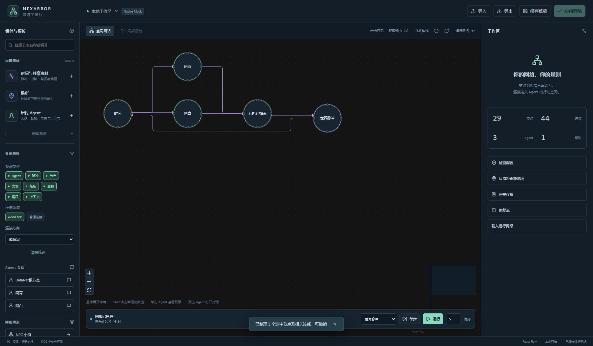

# Nexarbor 本地网络工作台

> 当前核心已改为 v7 纯频道协议。本轮只更新画布和核心，旧编辑器业务后端、NPC模板及 Harness 组件尚未迁移。下方搭建与运行步骤保留为此前版本的功能说明，当前不能据此启动完整小镇。查看新布线可运行本文末的隔离展示样例；详见[本轮验证](ROUTING_CHANNELS_V7_TEST_20261017.md)。

在图上创建节点、连接访问路径、装配模块并配置资料，然后应用为真实运行网络。单击 Agent 切换到其权限视角；双击打开该节点绑定的 Harness 对话。对话面板直接读取原生消息，发送通过原生 Agent 循环执行，使用宿主的模型与权限配置。


## 启动

当前开发版使用 Electron 桌面客户端、仓库源码后端（现有 `.venv`）和随组件附带的已构建界面，不需要在使用时运行前端编译器。旧 v0.4.0 Release 不包含工作台；本文不表示已发布新安装包。

Harness 插件入口为 `datanet-harness/network-editor`，配置参考仓库根目录 `network-editor.patch.yml`。保留既有 Harness 模型与自定义 Agent 循环配置，在新的工作区使用编辑器入口；同一工作区不要同时装配两个 Nexarbor 应用入口。编辑器组件集合在 `extensions/editor/extension.json` 声明，复用 NPC 与 foundation 组件。

在配置的编辑器工作区启动一份根会话后，选择根或其任意居民会话，点击会话顶部的“网络工作台”即可启动桌面工作台。入口复用官方 `conversation.session.header.actions` 插槽，经 Harness 原生认证获取工作台地址，不发送模型消息或推进世界。入口通过本地连接记录启动独立桌面窗口。没有连接到工作台的会话会给出提示；其他应用未启用工作台时不显示入口。


宿主也会写入 `<storage>/networks/<会话编号十六进制>/editor-connection.json`。命令行仍可用于直接打开当前工作台：

```powershell
python scripts/open_network_editor.py --storage E:/DataNet-模块化成品/editor-workspace/.datanet
```

也可以指定一份启动记录：

```powershell
python scripts/open_network_editor.py --connection <editor-connection.json的路径>
```

页面只监听本机，独立会话使用独立地址。启动地址带有本地访问凭据，页面读取后从地址栏移除。客户端刷新保留当前窗口的访问能力。

## 桌面客户端

当前 Windows x64 开发构建位于 `build/desktop/Nexarbor Workbench-win32-x64/Nexarbor Workbench.exe`。整个目录一起分发；可执行文件不单独复制。后端仍由 Harness 托管，关闭工作台窗口不结束 Agent。

```powershell
& './build/desktop/Nexarbor Workbench-win32-x64/Nexarbor Workbench.exe' --connection '<editor-connection.json的完整路径>'
```

首次没有连接记录时会弹出文件选择。之后记住连接文件路径，令牌只从连接记录读取。原生菜单提供打开连接、刷新、编辑和全屏。Renderer 开启 sandbox、contextIsolation、webSecurity，关闭 nodeIntegration；不向页面提供文件系统或执行 shell 的接口。连接只接受带凭据的本机地址。

安装到其他目录时用 `NEXARBOR_DESKTOP_EXECUTABLE` 指向程序；未设置时依次寻找本仓库构建、用户本地安装与开发版 Electron。构建说明：

```powershell
cd frontends/desktop
npm ci
npm test
npm run package
```

打包复用官方 Electron 和 @electron/packager，版本锁定。若 `build/` 已有对应官方 Electron zip，打包使用该缓存，否则由官方包下载。首次本机构建已校验官方 SHA256。桌面应用复用工作台界面与后端，当前未加入代码编辑器或 AI 编程功能。

## 从空网络搭建小镇

1. 点击“时间与共享资料”，加入脉冲、时间文本、计数存档、常识、地图及身份知识文本。
2. 添加场所。选择树林、矿坑、商店、铁匠铺、酒馆、居民楼、民政局或医院模板；它们由普通地址节点和挂载业务模块的服务节点组成。
3. 拖动场所右侧连接点到另一场所左侧连接点，保留 access.read、access.write 两个频道，并勾选反向连接，即形成双向道路。也可以独立编辑方向、频道、门槛、倍率和可见性。
4. 添加居民：填写编号、名字、职业、初始地点、人格和动机。模板复用原居民模块、身份知识、上下文装配、移动后刷新、工具装配及行动额度，建立在场和时间连接。人格成为独立文档节点，内容由使用者填写。
5. 在属性面板调整模块配置或状态。Agent 工具授予在 `agent.session` 模块的工具箱配置中；业务节点挂载何种模块决定提供哪些本地工具。
6. 检查配置、保存草稿、应用网络，再单步或运行有限时刻。暂停会等待当前时刻完成，不截断已经发生的业务操作。

“NPC 小镇”预设也可以整套载入草稿，再展开修改。节点、业务、职业、事件等仍是已有组件的组合。

场所模板及连线操作会更新地图文档；直接删除道路或手动重构后，可使用“从道路更新地图”。它按场所之间含 access.write 频道的连接生成可前往列表，数据来自当前草稿。使用者也可以随后手动编辑地图文档。

## 编辑与观察

- 节点默认是圆形加名称；悬停或键盘聚焦时展开详情卡片。卡片围绕原中心展开，不重新排布网络。拖动复用React Flow原生位置更新，连续跟随指针。节点使用固定尺寸，避免选择时重新测量导致短暂隐藏；拖动时使用React Flow的正交预览，松手后交给后台布线器重算，不再手工拼接旧主干。
- 连线采用横平竖直的折线和小圆角。libavoid自主选择进出节点的方向，处理避障、交叉惩罚和共用线段；降低为减少交叉而过度绕路的倾向，并惩罚折返。一次后台计算只包含本次实际替换的连线，结果整批应用，过时回复直接丢弃。每条真实连接仍可独立选择、查看和编辑，悬停时突出整条路径、显示频道，其他线淡化。
- Shift点击或Shift框选可多选；“全选可见”选中当前画布内的节点。“整理选中”用ELK减少选中节点之间的交叉，只改变这些节点的位置，能够撤销。“优化连线”只重算选中节点的相关线路，不移动节点。计算仅使用当前可见节点与连接，未显示的内容不作为障碍，也不参与合并。
- 筛选仅增减显示，保留原有节点位置、已绘线路和当前视角，不自动整理或重新分配端口。重新显示的节点、连接以及新添加的内容自动置顶。新线路需要计算时保留已有有效线路；移动时更新相关线路，并绕开当前可见的障碍。
- 连线合并属于显示方式，没有创建新的连接或修改权限。密集图不承诺零交叉；节点重叠或通道被堵时可调整位置再整理。为了保证筛选不跳图，重新显示的节点可能与原线路重叠，使用“优化连线”按当前画布重算即可。



- 节点类型、连接频道及名称筛选只改变显示。连线颜色按任意频道集合生成；没有内置读写颜色或私有虚线。
- 类型与频道按钮是显示开关，默认全部点亮；点击关闭对应类别，全部关闭时画布为空。“普通连接”表示没有频道标签的连接。“清除筛选”恢复全部显示；新出现的类别默认开启。
- 单击 Agent：后端使用核心 `walk_states` 按工具声明的频道分别计算实际可达范围，强度不超过该 Agent 实际授权。局部图中的边来自实际访问路径；展示筛选不授予新权限。尚未应用的节点需要先应用后才能查看真实权限。
- 双击 Agent 或点击左侧会话：打开原生对话面板。Agent 活动中可读，空闲时可发送。
- “模块”面板按组件自己的 JSON Schema 生成表单，可以装卸模块。状态与配置分开编辑；变更在应用后生效。
- `event.trigger` 模块提供执行图编辑器：调用、顺序、并行及分支，可以嵌套，操作指向本节点已挂载模块的方法。由现有 LangGraph 后端实际执行。
- `context.sources` 的来源列表支持系统提示词、持续上下文、新输入及尾部块。文本节点可在“资料”中编辑；文档也可导入为资源。
- 拖动布局、撤销重做、JSON 文件导入导出与草稿保存均不直接改变运行网络。

新模块通过组件清单的 `editor.modules` 指向配置定义，不需要给画布写专用表单。第一版覆盖 NPC 所需的25个模块及四种核心节点：普通、Agent、文本和脉冲。其他存储节点与前两个应用暂未纳入编辑器范围。

## 保存与恢复

草稿使用版本比较防止多个窗口互相覆盖。应用时还比较草稿基于的核心提交；运行网络发生变化后，旧草稿必须重新载入并整理，不能直接覆盖新的活动结果。应用后的草稿会标记为已应用，刷新优先展示最新运行状态。

配置先在临时工作区用相同组件进行构建、绑定和上下文检查。校验端口不会创建真实会话或运行模型。通过后才装配真实模块；保留同一节点的原生会话身份。发生应用错误会尝试恢复原网络，失败时进入只读恢复状态。

“完整存档”复用核心快照与原生上下文游标协调器。“恢复点”把网络、文件和各 Agent 的原生日志前缀恢复为独立分支，并打开该分支的工作台，保留原网络。它恢复已经提交的内部状态；外部系统效果不在回滚范围内。

此前业务后端在运行期间以及模块仍在停止时拒绝结构应用，每次运行1至20个时刻，单时刻有明确时间上限。当前核心已升级 v7，旧业务组件尚未迁移；旧网络与检查点拒绝加载，不自动转换，旧测试工作区应保留在备份版本中。

## 开发与验证

图编辑复用 [React Flow](https://reactflow.dev/)，表单复用 [react-jsonschema-form](https://github.com/rjsf-team/react-jsonschema-form)，不另写图编辑引擎。评估了 [Archify](https://github.com/tt-a1i/archify)：其展示图生成定位适合架构讲解，本工作台采用可编辑图组件连接真实后端。未复制 Archify 源码。

布局复用 [ELK.js](https://github.com/kieler/elkjs) 0.12.0；交叉减少、正交避障与共用主干由 [libavoid](https://github.com/Aksem/libavoid-js) 0.5.0-beta.5 与 [elkjs-libavoid](https://github.com/MrMint/elkjs-libavoid) 0.5.0 承担，在本地Worker中计算，不调用模型。参考Archify固定提交`88d1ae4498b6a1df610badf690c5406882622d15`的端点排序、已画线路避让和主干分支思路，未复制源码。工作台只适配圆形端点、选中范围、稳定筛选和层级。

拖动使用React Flow官方`applyNodeChanges`，悬停使用CSS过渡，没有自行实现动画引擎。依赖版本锁定在前端package-lock.json，许可、对应上游源码与替换构建说明在组件的[第三方声明](../extensions/editor/capabilities/network_editor/licenses/NOTICE.md)。

```powershell
cd frontends/network-editor
npm ci
npm run build
npm test
```

生产网页生成到编辑器组件的 `web/`，作为组件资源随源码和插件发布。只有修改前端源码时才需要这一步。

独立原生 Mock 测试宿主（60分钟硬上限、无外部模型请求）：

以下是此前版本的应用验收入口，当前 v7 暂不能运行。

```powershell
.venv/Scripts/python.exe scripts/run_network_editor_test.py
```

测试宿主在60分钟后结束。如果只想继续查看已保存的小镇，可重新打开同一份工作台，不发出模型输入：

```powershell
.venv/Scripts/python.exe scripts/run_network_editor_test.py --resume build/<本次目录>
```

已运行时该命令不会启动第二个宿主。重新打开后可用启动记录打开新地址；历史验收结果保持原文件，新增宿主状态写入`resumed-editor-state.json`。

它输出连接记录路径，可通过 `open_network_editor.py --connection` 打开。测试宿主使用真实 Harness SDK、AgentLoop、工具运行时、JSONL和检查点，模型回复是确定性 Mock，因此只能验证结构与交互，不代表真实模型决策质量。

浏览器验收脚本为 `frontends/network-editor/test/browser.acceptance.mjs`，参数是该次测试目录；使用独立无头 Edge。测试从空草稿开始，通过界面建立两个场所、两个居民和道路，验证并行执行、移动、交谈、行动额度、真实对话读写与恢复工作台。

本次桌面与统一频道结果见[实施与验证](DESKTOP_CHANNELS_TEST_20261017.md)，原版浏览器工作台结果见[验证记录](NETWORK_EDITOR_TEST_20261017.md)，Agent 可见内容见[文本核对](NETWORK_EDITOR_TEXT_REVIEW_20261017.md)。原版 Harness 的测试客户端能够列出全部会话并读取真实历史；测试启动脚本会实际安装会话展示辅助插件，校验其加载状态及全部标题。工作台自己的会话列表直接显示节点名称及对应会话。

## 当前布线展示

新核心的画布验收使用五节点、六条连接的展示数据，不启动模型或调用旧应用组件。可在独立终端启动60分钟展示服务，再打开其连接记录：

```powershell
cd frontends/network-editor
node test/visual-fixture.mjs
```

```powershell
& './build/desktop/Nexarbor Workbench-win32-x64/Nexarbor Workbench.exe' --connection './build/routing-v7/preview/editor-connection.json'
```

第二条命令从仓库根目录执行。展示窗口明确标注“不运行Agent”，仅用于拖动、筛选与整理查看，不能保存网络或运行世界。自动桌面验收从前端目录执行 `node test/desktop.routing.mjs`。

客户端要求选择的JSON是正在运行的后端生成的连接记录；当前展示服务将它写入 `build/routing-v7/preview/editor-connection.json`。选择此文件即可连接，不选择网络存档或预设JSON。展示服务有60分钟上限，过期后重启上面的Node命令，再打开同一路径。桌面快捷方式直接启动可执行文件，可通过 `--connection` 绑定该记录。

本仓库的 `run_network_editor_test.py`、`run_npc_minimal_test.py` 和 `open_harness_test_client.py` 启动子进程时，把TEMP/TMP/TMPDIR设为仓库的 `build/harness-temp`。项目位于E盘时，这些测试的工作区快照等临时文件也写入E盘；不修改Windows用户临时目录，不影响普通方式启动的Harness。
