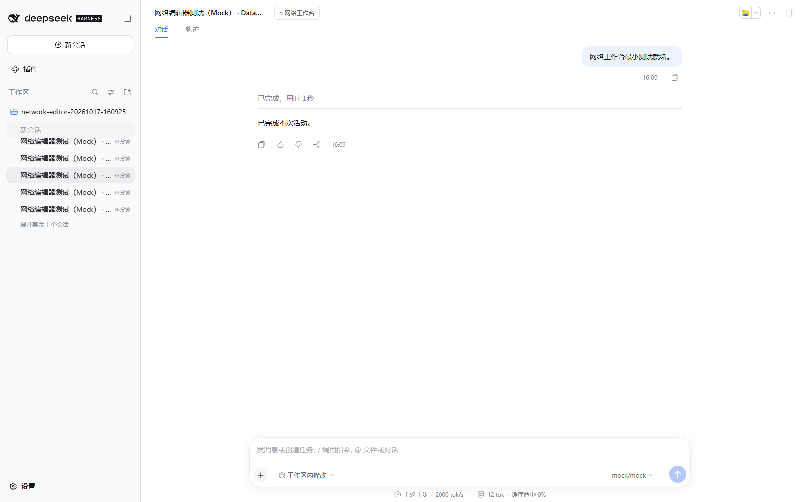

# Nexarbor 本地网络工作台

在图上创建节点、连接访问路径、装配模块并配置资料，然后应用为真实运行网络。单击 Agent 切换到其权限视角；双击打开该节点绑定的 Harness 对话。对话面板直接读取原生消息，发送通过原生 Agent 循环执行，使用宿主的模型与权限配置。


## 启动

当前开发版使用仓库源码后端（现有 `.venv`）和随组件附带的已构建网页，不需要在使用时运行前端编译器。旧 v0.4.0 Release 不包含工作台；本文不表示已发布新安装包。

Harness 插件入口为 `datanet-harness/network-editor`，配置参考仓库根目录 `network-editor.patch.yml`。保留既有 Harness 模型与自定义 Agent 循环配置，在新的工作区使用编辑器入口；同一工作区不要同时装配两个 Nexarbor 应用入口。编辑器组件集合在 `extensions/editor/extension.json` 声明，复用 NPC 与 foundation 组件。

在配置的编辑器工作区启动一份根会话后，选择根或其任意居民会话，点击会话顶部的“网络工作台”即可打开对应的本地页面。入口复用官方 `conversation.session.header.actions` 插槽，经 Harness 原生认证获取工作台地址，不发送模型消息或推进世界。当前通过新页面打开，不是内嵌画布。没有连接到工作台的会话会给出提示；其他应用未启用工作台时不显示入口。



宿主也会写入 `<storage>/networks/<会话编号十六进制>/editor-connection.json`。命令行仍可用于直接打开当前工作台：

```powershell
python scripts/open_network_editor.py --storage E:/DataNet-模块化成品/editor-workspace/.datanet
```

也可以指定一份启动记录：

```powershell
python scripts/open_network_editor.py --connection <editor-connection.json的路径>
```

页面只监听本机，独立会话使用独立地址。启动地址带有本地访问凭据，页面读取后从地址栏移除。浏览器刷新仍保留当前标签页的访问能力。

## 从空网络搭建小镇

1. 点击“时间与共享资料”，加入脉冲、时间文本、计数存档、常识、地图及身份知识文本。
2. 添加场所。选择树林、矿坑、商店、铁匠铺、酒馆、居民楼、民政局或医院模板；它们由普通地址节点和挂载业务模块的服务节点组成。
3. 拖动场所右侧连接点到另一场所左侧连接点，选择同时建立读写、反向连接，即形成双向道路。也可以独立编辑方向、频道、门槛、倍率和可见性。
4. 添加居民：填写编号、名字、职业、初始地点、人格和动机。模板复用原居民模块、身份知识、上下文装配、移动后刷新、工具装配及行动额度，建立在场和时间连接。人格成为独立文档节点，内容由使用者填写。
5. 在属性面板调整模块配置或状态。Agent 工具授予在 `agent.session` 模块的工具箱配置中；业务节点挂载何种模块决定提供哪些本地工具。
6. 检查配置、保存草稿、应用网络，再单步或运行有限时刻。暂停会等待当前时刻完成，不截断已经发生的业务操作。

“NPC 小镇”预设也可以整套载入草稿，再展开修改。节点、业务、职业、事件等仍是已有组件的组合。

场所模板及连线操作会更新地图文档；直接删除道路或手动重构后，可使用“从道路更新地图”。它按场所之间的写连接生成可前往列表，数据来自当前草稿。使用者也可以随后手动编辑地图文档。

## 编辑与观察

- 节点类型、连接频道、方向及名称筛选只改变显示。私有连接显示为虚线。
- 单击 Agent：后端使用核心 `walk_states` 计算读写范围，强度不超过该 Agent 实际授权。局部图中的边来自实际访问路径；展示筛选不授予新权限。尚未应用的节点需要先应用后才能查看真实权限。
- 双击 Agent 或点击左侧会话：打开原生对话面板。Agent 活动中可读，空闲时可发送。
- “模块”面板按组件自己的 JSON Schema 生成表单，可以装卸模块。状态与配置分开编辑；变更在应用后生效。
- `event.trigger` 模块提供执行图编辑器：调用、顺序、并行及分支，可以嵌套，操作指向本节点已挂载模块的方法。由现有 LangGraph 后端实际执行。
- `context.sources` 的来源列表支持系统提示词、持续上下文、新输入及尾部块。文本节点可在“资料”中编辑；文档也可导入为资源。
- 拖动布局、撤销重做、JSON 文件导入导出与草稿保存均不直接改变运行网络。

新模块通过组件清单的 `editor.modules` 指向配置定义，不需要给画布写专用表单。第一版覆盖 NPC 所需的25个模块及四种核心节点：普通、Agent、文本和脉冲。其他存储节点与前两个应用暂未纳入编辑器范围。

## 保存与恢复

草稿使用版本比较防止多个窗口互相覆盖。应用时还比较草稿基于的核心提交；运行网络发生变化后，旧草稿必须重新载入并整理，不能直接覆盖新的活动结果。应用后的草稿会标记为已应用，刷新优先展示最新运行状态。

配置先在临时工作区用相同组件进行构建、绑定和上下文检查。校验端口不会创建真实会话或运行模型。通过后才装配真实模块；保留同一节点的原生会话身份。发生应用错误会尝试恢复原网络，失败时进入只读恢复状态。

“完整存档”复用核心快照与原生上下文游标协调器。“恢复点”把网络、文件和各 Agent 的原生日志前缀恢复为独立分支，并打开该分支的工作台，保留原网络。它恢复已经提交的内部状态；外部系统效果不在回滚范围内。

运行期间以及模块仍在停止时拒绝结构应用。每次运行1至20个时刻，单时刻有明确时间上限。现有六天 NPC 存档未做自动迁移，建议新建工作区进行编辑器实验。

## 开发与验证

图编辑复用 [React Flow](https://reactflow.dev/)，表单复用 [react-jsonschema-form](https://github.com/rjsf-team/react-jsonschema-form)，不另写图编辑引擎。评估了 [Archify](https://github.com/tt-a1i/archify)：其展示图生成定位适合架构讲解，本工作台采用可编辑图组件连接真实后端。未复制 Archify 源码。

```powershell
cd frontends/network-editor
npm ci
npm run build
npm test
```

生产网页生成到编辑器组件的 `web/`，作为组件资源随源码和插件发布。只有修改前端源码时才需要这一步。

独立原生 Mock 测试宿主（60分钟硬上限、无外部模型请求）：

```powershell
.venv/Scripts/python.exe scripts/run_network_editor_test.py
```

它输出连接记录路径，可通过 `open_network_editor.py --connection` 打开。测试宿主使用真实 Harness SDK、AgentLoop、工具运行时、JSONL和检查点，模型回复是确定性 Mock，因此只能验证结构与交互，不代表真实模型决策质量。

浏览器验收脚本为 `frontends/network-editor/test/browser.acceptance.mjs`，参数是该次测试目录；使用独立无头 Edge。测试从空草稿开始，通过界面建立两个场所、两个居民和道路，验证并行执行、移动、交谈、行动额度、真实对话读写与恢复工作台。

本次结果见[验证记录](NETWORK_EDITOR_TEST_20261017.md)，Agent 可见内容见[文本核对](NETWORK_EDITOR_TEXT_REVIEW_20261017.md)。原版 Harness 的测试客户端能够列出全部会话并读取真实历史；测试启动脚本会实际安装会话展示辅助插件，校验其加载状态及全部标题。工作台自己的会话列表直接显示节点名称及对应会话。
