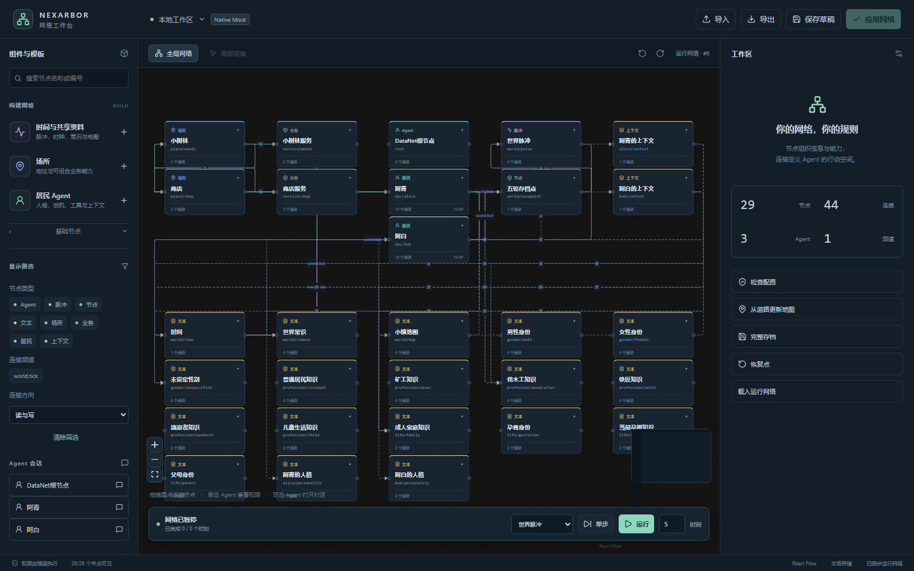

# 本地网络工作台验证记录

日期：2026-10-17。范围为可选网络编辑器及 NPC 组合模板。本次验证使用真实 Harness SDK、AgentLoop、工具运行时和原生 JSONL 持久化，模型回复由确定性 Mock 提供；外部模型 API 调用和费用均为0，不代表真实模型的自主决策质量。

测试夹具替换了官方工具预设的装配入口 `applyCapabilities` / `updateCapabilityTools`，未装配终端、浏览器等官方工具；网络业务工具仍经过真实工具运行时执行。因此这次结果覆盖网络工作台、原生循环和会话持久化，不覆盖官方工具授权预设或发布安装包的完整启动。

## 验收结果

浏览器从空草稿开始，通过界面建立小树林、商店、双向道路及阿青/阿白两名居民，装配时间与共享资料后得到29节点、44连接的实际网络。没有直接调用API写图，也没有手工修改测试网络的JSON。

| 项目 | 结果 |
|---|---|
| 模板与表单 | 场所、居民、人格、动机及连线均通过界面创建并应用 |
| 单击 Agent | 核心按实际读写路径计算局部视角，能见同地居民与相邻地址，不能越界获得相邻业务 |
| 双击 Agent | 打开实际绑定的原生会话，发送输入后得到原生 AgentLoop 生成的 Mock 回复 |
| 一次脉冲 | 约3.97秒完成；两位居民处于同一传播层，完成后脉冲回到源节点 |
| 阿青 | 交谈1、砍树6、移动3，行动值用满10；得到木材2，移动至商店 |
| 阿白 | 交谈消耗1行动值，留在树林 |
| 恢复 | 从检查点建立独立原生日志前缀分支，打开新的工作台；位置、行动值及原生聊天记录保留 |
| 客户端列表 | 原始根与两NPC、恢复根与两NPC，共6个原生会话均可列出并读取历史 |
| 浏览器 | 最终页面无未捕获脚本错误；生产资源构建成功 |

本次验收记录9次Mock模型调用：世界活动6次、初始根会话1次、聊天入口2次。Mock回复内容由脚本选择工具，不把这9次计作真实API开销。恢复后的读取检查没有再次运行NPC或请求模型。

原生测试中两NPC同属一层；另由Python测试用双参与方Barrier确保两个工作者同时进入，若串行运行会超时失败。原生Mock流式请求的重叠峰值为1，这个指标不能证明或否定NPC工作者并行，本报告不据此声称模型流并发。



## 其他检查

Python主验收5项通过，另补充1项待处理原生输入的保护检查通过：完整51节点预设可构建；空图可组合；应用保留同一Agent身份；草稿版本和运行提交防止覆盖；资源越界与无效引用/执行图在应用前拒绝；并行工作、行动额度和冷恢复正确；即使原生状态暂为idle，有待处理输入时也拒绝结构修改。

JS3项通过：显示筛选不改权限或图；删除节点清理连接且保护根；本地HTTP服务验证凭据和来源，只经显式宿主操作分发，并能正确解码跨数据块的中文JSON。最终前端生产构建通过。

页面使用独立无头Edge测试，没有操作使用者的浏览器资料。按使用者要求，核实记录PID、进程命令及独立测试资料目录后，关闭了旧编辑器测试客户端、旧行动额度测试客户端和旧编辑器Mock宿主，保留本次最终验收客户端，未关闭使用者自己的客户端。

## 证据与重现

本机运行目录：`build/network-editor-20261017-160925/`，包含：

- `browser-verification.json`：界面建图、聊天、状态及恢复检查。
- `acceptance-state.json`：脉冲报告、实际网络和Mock请求清单。
- `sessions-manifest.json`、`sidebar-verification.json`：6个原生会话及历史读取结果。
- `native-logs/`：原生日志；`.datanet/`：网络及恢复工作区。
- `02-local-perspective.png`、`06-restored-graph.png`、`07-restored-workbench.png`：局部视角、恢复图及聊天截图。

这些运行数据位于Git忽略的build目录。仓库仅保存一张无凭据的界面截图和本报告，不上传本地会话日志或访问凭据。

```powershell
.venv/Scripts/python.exe tests/test_network_editor.py
cd frontends/network-editor
npm ci
npm test
npm run build
```

原生宿主和浏览器流程：

```powershell
# 仓库根目录；输出一个新的build测试目录
.venv/Scripts/python.exe scripts/run_network_editor_test.py
# 从frontends/network-editor运行，参数替换为上一步输出目录
node test/browser.acceptance.mjs ../../build/<本次目录>
# 仅读取已恢复结果，不再运行世界
node test/browser.restore-check.mjs ../../build/<本次目录>
```

## 当前边界

编辑器第一版支持NPC所需25个模块及普通、Agent、文本、脉冲四种节点。前两个应用的特殊存储节点尚未纳入；旧六天世界存档未迁移。工作台只监听本机，使用独立访问凭据；结构应用需要当前任务及原生输入处理完成。

原版Harness冷启动列表的可选标题缓存仍可能缺失，因而会先显示“未命名”。验收独立核实了持久标题、全部会话条目和真实历史可读，没有把缺少缓存视作标题已经显示。工作台自己的会话入口直接显示节点名称。

本次不包含真实付费模型、完整世界运行、新客户端EXE打包或Release发布。使用当前源码后端与组件附带的预构建网页，配置入口见[使用说明](NETWORK_EDITOR.md)。
