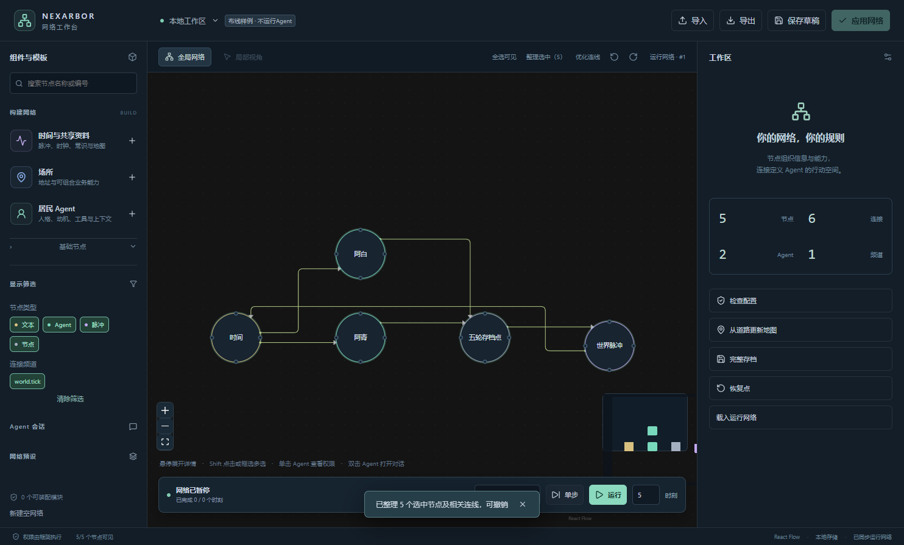

# 布线显示与 v7 纯频道核心

2026-10-17。基线 `4d543f4`，备份分支 `backup/pre-routing-channel-v7-20261017`。所有源码、构建和客户端产物位于 `E:/DataNet-模块化成品`。本轮仅本地提交，不推送。

## 显示调整

截图中的绕大圈与折返，主要来自手动固定端口、旧主干拼接，以及一次计算全部边却只采用部分结果。现由 libavoid 自选端口；拖动复用 React Flow 正交预览，松手后原子替换本次计算的路径。过期后台结果丢弃。交叉成本、折弯与反向成本共同约束路径，避免为了少一个交叉过度绕路。

“整理选中”和“优化连线”继续以选中、可见图为范围。筛选不改变已有布局与有效线路，新显示内容置顶。保留圆形节点、悬停详情、正交线和小圆角。共用线段交给布线器决定，不手工拼接不同批次的主干；不承诺任意密集图零交叉。

本图为隔离展示数据，没有模型运行。桌面验收使用现有 Electron 客户端，不依赖尚未迁移的应用后端。

## 核心调整

- 网络格式升级 v7；接口元数据为频道、门槛、倍率和扩展属性，去掉 visibility。
- 去掉 read_only 推断和内置 access.read/access.write；公开工具注册必须显式声明 access_channels。
- Network 和 Backend 删除特殊远程 read/write 入口，远程数据读写统一走普通工具调用。本地存储方法保留。
- 工具开放清单、工具箱授予、Agent 私有工具、管理与委托授权仍独立存在。
- 同步访问与信号按频道交集连通，频道集合全程保留。private/public 没有特殊含义，主动携带两者可以跨越两类连接。
- 默认空频道只到达自身。文本工具的频道通过 tool_channels 配置，并持久保存。

本轮没有改 foundation、storage、multi_agent、knowledge_base、npc_world 中的业务组件或预设；编辑器扩展目录仅更新编译后的网页资源。旧应用、旧 Harness 桥接及旧存档暂不兼容，不以旧应用测试通过作为本轮结论。

## 验证

核心测试禁用所有扩展：DATANET_COMPONENT_ROOT 指向不存在的目录，DATANET_COMPONENT_SELECTION 为 []，DATANET_COMPONENT_PROFILE 为 {}。

| 范围 | 通过 |
|---|---:|
| 工具频道、组合频道、显式开放、嵌套约束、文本恢复 | 9 |
| Backend 普通工具调用、旧RPC拒绝、存档恢复 | 1 |
| 信号传播、脉冲、并行层屏障、取消和恢复 | 20 |
| Agent四类输入 | 4 |
| 增量日志与快照 | 11 |
| 子进程强制中断恢复 | 2 |
| 前端模型、布局、布线和入口认证 | 11 |

合计47项Python测试和11项前端测试通过。生产网页构建通过；构建器仍提示现有依赖的 use client 指令与大文件体积，不影响构建完成。

另用真实 Electron 窗口执行指针拖动、筛选、局部优化和全选整理，验证六条连接均为正交路径、松手后无残留预览、筛选保持视角和线路、局部优化保留其他边，页面错误为0。原始机器报告：`build/routing-v7/desktop-routing-verification.json`；截图位于同目录。无付费API调用，没有运行全世界或旧应用端到端测试。

## Agent可见文本与接口变化

没有修改旧应用的提示词文件。核心创建工具的描述改为：

> 在管理范围内的父节点下面创建子节点，不创建Agent。先查看 list_node_presets。默认父节点为自己，默认建立空频道连接，远程访问须显式配置频道。

核心概况查询 list_nodes 的描述：

> 列出沿指定频道可达的节点概况；不授予工具调用权限。

其 channels 参数描述改为：

> 本次概况查询的频道；省略时仅查询自身，不授予工具调用权限。

接口编辑参数已去掉 visibility；公开工具定义去掉 read_only，保留显式 access_channels。模型调用 invoke_tool 仍不填写频道。创建默认空频道不隐含授予读取或修改能力。

协议细节见[频道与工具授权](CHANNEL_ACCESS.md)，画布展示启动方式见[工作台指南](NETWORK_EDITOR.md)。
