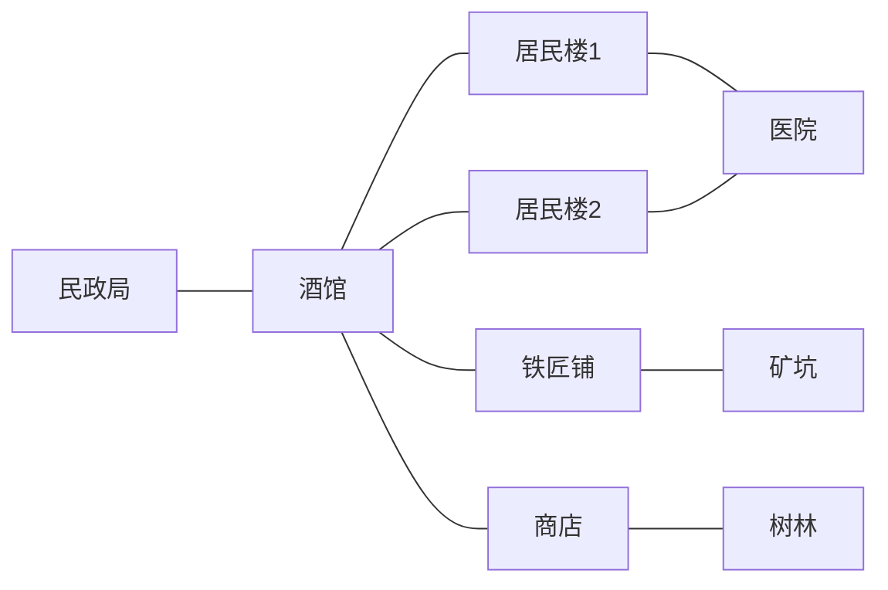

# 应用三：离散时间 NPC 小世界

同一个权限图框架，换一种应用：NPC 的位置通过动态接口表达，当前能接触的人、业务和移动入口由图遍历决定。业务不进入核心，Harness 继续承担会话、模型循环和前端。

## 已实现

- 九个地点、公共道路和六名独立居民。当前地点业务、邻居移动入口、同场所居民恰好处于强度2的访问范围内。
- 地址节点仅暴露 `move_here`；业务工具挂在独立服务节点。移动结算时迁移双向在场连接，下一时刻自动失去旧工具、获得新工具。
- 每天五个时刻，居民并行选择行动、提交后统一结算。每人每时刻默认最多8次模型请求、120秒执行上限；轮次默认180秒。失败者等待，其他人继续。操作入口一次只推进一个时刻，不持续后台运行。
- 交谈、赠送钱/材料、休息、饮料、买卖、挖矿、砍树、修理、双方同意的结婚与家庭计划。
- 两天孕期、临近提醒、自主到院、到期生产。出生创建真正的儿童 Agent 节点和独立 Markdown 记忆，下一时刻参与。
- 只读常识、私人记忆、局部信箱、原子检查点。中途恢复保留已提交计划和剩余请求预算；重复结算不会重复执行业务或出生。

这是一个有明确规则的小世界演示。经济、成长和生理规则有意简化；社交圈共享记忆等未来能力尚未加入。完整世界真实模型运行留给后续演示，本次只验证局部链路。

## 启用

作为独立 Harness 应用可使用包入口 `datanet-harness/npc-world`（默认导入 `small_town`）；也可复用现有 `datanet-harness` 插件并配置：

```yaml
extensionRoot: E:/DataNet-模块化成品/extensions/npc_world
rootNetwork: small_town
rootToolboxes: [world_operator]
allowedAgentToolboxes: [world_resident]
agentMaxTokens: 4096
worldMaxRequests: 8
```

源码运行沿用现有 `backend`/`backendArgs` Python 桥接配置，插件的 `workspace` 应是独立工作区。节点与世界状态按根会话隔离保存在其 `.datanet/networks/` 下。无需新UI。

在入口会话让操作 Agent “观察世界”或“推进一个时刻”。首次打开只装配会话，不调用居民模型。`world_observe` 返回会话ID，用户可在 Harness 打开对应居民会话。用户在空闲时进入居民会话可以交流；改变世界的行动须在已开启时刻提交。操作入口的指南按使用工具时披露。

局部测试：`world_round(begin)` → `world_run_npc(target=...)` → `world_round(cancel)`，最后一步让其余人等待并结算已提交计划。`worldAllowFullRun: false` 可在测试配置中禁止整世界 `run`。

## 组件与复用

| 单元 | 职责 | 来源 |
|---|---|---|
| 核心图、Agent节点、文本节点、检查点 | 权限、身份、私有记忆与原子恢复 | 直接复用，核心未改 |
| foundation/agent_runtime | 装配、恢复、执行 Agent 与记忆工具 | 直接复用 |
| foundation/network_access | 按图发现和调用服务 | 复用；补充可信调用者上下文，不接受模型冒充身份 |
| foundation/round_barrier | 唯一参与者、幂等提交、到期缺席与收齐屏障 | 新的通用能力，可用于其他离散协作 |
| npc_world/world_state | 世界状态、在场连接、节点编解码、观察与提交 | 应用能力 |
| npc_world/place_actions | 场所工具、业务规则和统一结算 | 应用能力 |
| npc_world/world_runtime | 原生事件、轻量尾部、限额并行执行 | 应用能力 |
| npc_resident / npc_child | 成人与儿童角色提示 | 配置与文档 |
| world_resident / world_operator | 居民与操作入口的授权工具列表 | 配置 |
| small_town | 地图、道路、初始人物、库存与只读常识 | 配置与文档 |

地点服务参数没有 actor 字段，真实调用者从图工具通道的上下文取得。访问后还会验证位置和本轮提交状态。公开居民工具只含交流与赠送，不能读取对方私有记忆。通用网络管理、终端、联网和子Agent创建工具均未装配给居民。

地点业务先记意图：一个人本时刻最后选中的主要行动在提交时冻结。统一结算先处理原位置业务，再一起移动。每项业务在状态副本上验证和应用，失败不扣钱、不发物；处理顺序随时刻轮换。整个世界状态、图和文件由现有检查点持久化。儿童采用确定ID，出生已提交但会话装配失败时，可在恢复后补装而不重复出生。

交谈使用持久局部信箱，按需读取，不开启额外模型轮次。未直接复用原有管理消息组件的自动唤醒规则，以保持离散时间屏障；会话执行和工具传输仍复用已有机制。

## 初始地图



情侣林舟/月宁从居民楼1出发；阿森在树林；石岩在矿坑且镐子已损坏；老锤在铁匠铺；小路在酒馆。只给个人初始打算，不预写行动剧本。

[验证记录](VALIDATION.md) · [Agent文档与描述审阅清单](AGENT_TEXT_REVIEW.md)
