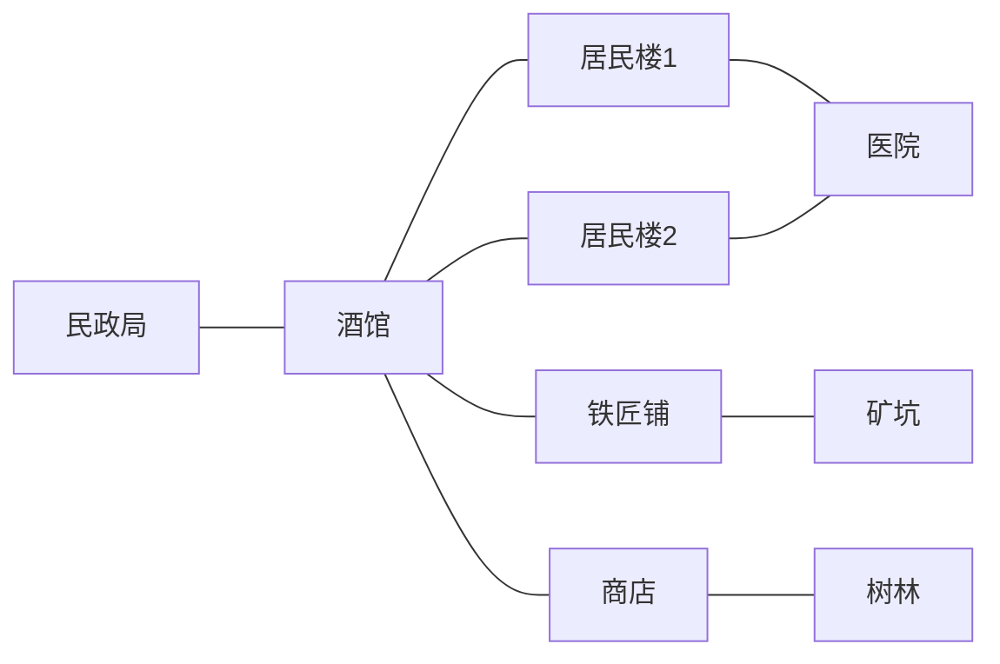

# 应用三：离散时间 NPC 小世界

同一个权限图框架，换一种应用：NPC 的位置通过动态接口表达，当前能接触的人、业务和移动入口由图遍历决定。业务不进入核心，Harness 继续承担会话、模型循环和前端。

## 已实现

- 九个地点、公共道路和六名独立居民。当前地点业务、邻居移动入口、同场所居民恰好处于强度2的访问范围内。
- 地址节点仅暴露 `move_here`；业务工具挂在独立服务节点。移动结算时迁移双向在场连接，下一时刻自动失去旧工具、获得新工具。
- 每天五个时刻，居民并行选择行动，正常结束后框架自动记录，再统一结算。每人每时刻默认最多8次模型请求、90秒执行上限；轮次默认180秒。失败者等待，其他人继续。操作入口一次只推进一个时刻，不持续后台运行。
- 交谈、赠送钱/材料、休息、饮料、买卖、挖矿、砍树、修理、双方同意的结婚与家庭计划。
- 两天孕期、临近提醒、自主到院、到期生产。出生创建真正的儿童 Agent 节点和独立 Markdown 记忆，下一时刻参与。
- 只读常识、私人记忆、局部信箱、原子检查点。保存保留图、行动计划、脉冲进度与请求记录；中断中的脉冲需要先核对效果，不会自动重放。重复结算不会重复执行业务或出生。

这是一个有明确规则的小世界演示。经济、成长和生理规则有意简化；社交圈共享记忆等未来能力尚未加入。完整世界真实模型运行留给后续演示，本次只验证局部链路。

## 启用

作为独立 Harness 应用可使用包入口 `datanet-harness/npc-world`（默认导入 `small_town`）；也可复用现有 `datanet-harness` 插件并配置：

```yaml
extensionRoot: E:/DataNet-模块化成品/extensions/npc_world
rootNetwork: small_town
rootToolboxes: [world_operator]
allowedAgentToolboxes: [world_resident]
agentMaxTokens: 4096
worldMaxRequests: 8
```

源码运行沿用现有 `backend`/`backendArgs` Python 桥接配置，插件的 `workspace` 应是独立工作区。节点与世界状态按根会话隔离保存在其 `.datanet/networks/` 下。无需新UI。

在入口会话让操作 Agent “观察世界”或“推进一个时刻”。首次打开只装配会话，不调用居民模型。`world_observe` 返回会话ID，用户可在 Harness 打开对应居民会话。用户在空闲时进入居民会话可以交流；改变世界的行动须在脉冲启动的居民活动中选择。操作入口的指南按使用工具时披露。

局部测试只调用一次 `world_run_npc(target="world/npc/woodcutter")`：只唤醒指定居民，正常结束后自动结算并推进一个时刻，其余居民不启动。`worldAllowFullRun: false` 可在测试配置中禁止 `world_round`。

## 组件与复用

| 单元 | 职责 | 来源 |
|---|---|---|
| 核心图、Agent节点、信号、PulseNode、检查点 | 权限、身份、逐层等待执行与闭环 | 复用新核心通用机制 |
| foundation/agent_runtime | 装配、恢复、执行 Agent 与记忆工具 | 直接复用 |
| foundation/network_access | 按图发现和调用服务 | 复用；补充可信调用者上下文，不接受模型冒充身份 |
| foundation/text | 普通文本与按需查询 | 时间为普通文本，自动装配由独立模块承担 |
| npc_world/world_state | 世界状态、在场连接、节点编解码、时钟与完成记录 | 应用能力 |
| npc_world/place_actions | 场所工具、业务规则和统一结算 | 应用能力 |
| npc_world/world_runtime | 原生事件、轻量尾部、信号处理器与限额并行执行 | 应用能力 |
| npc_resident / npc_child | 成人与儿童通用角色提示 | 配置与文档 |
| resident_knowledge | 性别、职业、家庭及孕期知识的匹配条件与文本 | 纯配置与文档；复用普通文本节点 |
| foundation/signal_response | 按频道执行节点的有序工具步骤 | 通用可选组件 |
| foundation/context_assembly | 专用装配节点组织四类输入，支持真实文档与节点来源 | 通用可选组件，无信号/元数据扩展器依赖 |
| foundation/node_metadata | 为任意节点提供分命名空间元数据 | 通用可选组件，不改核心节点字段 |
| world_resident / world_operator | 居民与操作入口的授权工具列表 | 配置 |
| small_town | 地图、道路、初始人物、库存与只读常识 | 配置与文档 |

地点服务参数没有 actor 字段，真实调用者从图工具通道的上下文取得。访问后还会验证位置和本轮信号参与和完成状态。公开居民工具只含交流与赠送，不能读取对方私有记忆。通用网络管理、终端、联网和子Agent创建工具均未装配给居民。

地点业务先记意图：一个人本时刻最后选中的主要行动在Agent正常结束时冻结。统一结算先处理原位置业务，再一起移动。每项业务在状态副本上验证和应用，失败不扣钱、不发物；处理顺序随时刻轮换。整个世界状态、图和文件由现有检查点持久化。儿童采用确定ID，出生已提交但会话装配失败时，可在恢复后补装而不重复出生。

交谈使用持久局部信箱，按需读取，不开启额外模型轮次。未直接复用原有管理消息组件的自动唤醒规则，以保持离散时刻边界；会话执行和工具传输仍复用已有机制。

## 脉冲接线

```text
world/pulse --world.tick--> world/time --world.tick--> NPC --world.tick--> world/pulse
```

这是强度3的公有写边环，每条边阈值1。核心按广度逐层执行：更新时间文本 → 并行运行订阅居民 → 返回源节点。NPC的频道响应器按responses.json依次执行上下文装配和Agent运行，等待原生Agent循环的正常 `turn/end(completed)`，再冻结行动并返回；没有手工提交工具。源节点收到返回信号后，本次运行统一结算。当前操作入口每次只发一轮，不自动连续运行。

每个NPC以私有读边连接自己的装配节点，装配节点私有指向时间与获准知识节点；人格是明确清单中的只读文档资源。NPC不再直接读取时间；时间正文通过核心tail口进入请求底部，时间节点不暴露工具。地图道路与业务边没有 `world.tick` 频道，因此脉冲不会沿地图扩散。场所业务仍通过独立的强度2访问权限发现和调用，不消耗脉冲传播强度。

居民异常退出不算正常完成，不传播其返回分支；其他正常居民仍能回环，失败者按等待结算。中断的PulseNode保留状态以供核对，不自动重放已经产生效果的请求。前两个应用未在此次迁移范围内。

## 分层身份、知识与私人记忆

共同生活规则保留在只读世界常识中。身份与专属知识由 `nodes/resident_knowledge/profiles.json` 配置匹配，内容是独立Markdown，实例化为普通只读文本节点。NPC以私有读边连接匹配的节点；同职业共享同一份职业文本，其他居民不能借它的在场连接继续读取这些私有边。地图移动保留职业知识，职业改变则重新匹配。

- 性别描述：男性、女性、未设定三种短描述；不绑定性格或职业。
- 职业描述和知识：普通居民、矿工、伐木工、铁匠、流浪者、儿童。匹配正文按授权连接作为独立历史文档注入。
- 成人家庭知识：只注入独立的查询入口，按需使用既有 `node_read` 阅读。
- 孕育能力、当前怀孕、已为父母：分别按真实状态匹配。性别与孕育能力独立；仅当前孕者获得两天孕期和到院生产说明。出生结算后撤下当前孕期资料及提示片段，双方获得父母身份。
- 私人经历：仍使用原Agent Markdown记忆和读写工具，不与共享职业文本混写。

`world_look.knowledge` 列出当前获准知识节点。NPC不能修改这些节点。身份、职业、状态和初始目标由节点元数据扩展器的npc提供器从已有业务状态读取，不新增核心Agent字段。附加自定义属性也可放在npc命名空间，但不能覆盖业务提供器维护的字段。所有读方通过核心get_metadata/describe统一取得标准字段和获准的extensions；未装扩展器就只有标准字段，不要求工具逐个适配。上下文装配器通过核心四口交付输入，历史文档由原生标记补载；固定人格作为独立系统section，Harness自行比较变化，时间走请求尾部。状态变化追加最新元数据及失配文档通知，不删除已有历史或私人记忆。

响应器配置见 `network_presets/small_town/responses.json`：时间节点匹配world.tick后调用更新时间工具，NPC匹配后依次调用assemble_context和world_run_actor。三个共享模块都不认识小镇业务，NPC只负责绑定提供器、工具和配置。

增加一种身份知识通常只需新增Markdown并添加匹配配置；`when` 用JSON Pointer匹配统一元数据，例如 `/extensions/npc/role`、`/extensions/npc/life_stage`、`/extensions/npc/pregnant` 和 `/extensions/npc/is_parent`。没有新增Agent工具或NPC专用核心节点类型；核心只新增通用四类输入契约。六名初始居民在town.json显式配置性别；新生儿默认未设定。

## 初始地图



情侣林舟/月宁从居民楼1出发；阿森在树林；石岩在矿坑且镐子已损坏；老锤在铁匠铺；小路在酒馆。只给个人初始打算，不预写行动剧本。

[验证记录](VALIDATION.md) · [Agent文档与描述审阅清单](AGENT_TEXT_REVIEW.md)

## 固定人格与四类输入

六名初始居民各有独立只读人格文件，儿童使用人格模板；文件不向NPC开放写入。人格、条件知识、每时刻新任务和短时钟/状态分别交给system_prompt/context/inputs/tail口。所有四口及独立装配器均支持真实UTF-8文档引用。来源和权限、更新/去重/恢复规则见[装配机制](../../CONTEXT_ASSEMBLY.md)；全部新增人格原文见[本轮文案审阅](CONTEXT_ASSEMBLY_REVIEW.md)。
